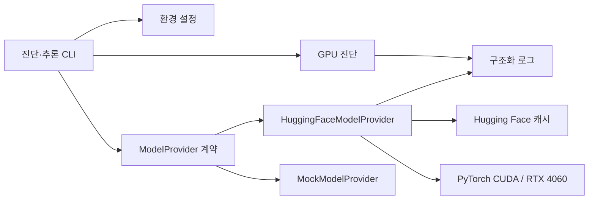

# Local AI CAD — Phase 1 설계

- 상태: 구현 전 설계 확정
- 범위: 로컬 GPU에서 Hugging Face 모델을 한 번 로드하고 단일 요청 추론을 실행하며 성능 로그를 남기는 단계
- 대상 모델: `Qwen/Qwen2.5-1.5B-Instruct`

## 1. 목표와 완료 기준

Phase 1의 목적은 CAD 기능 구현이 아니라 현재 Windows 호스트의 RTX 4060에서 로컬 LLM 기준선을 재현 가능하게 확보하는 것이다. 전체 단계 중 이 Phase의 위치는 `docs/roadmap.md`를 참조한다.

다음 조건을 모두 충족해야 완료로 판단한다.

1. 독립된 Python 3.11 가상환경에서 애플리케이션을 실행한다.
2. PyTorch가 CUDA를 사용할 수 있고 RTX 4060을 인식한다.
3. `Qwen/Qwen2.5-1.5B-Instruct`를 서버 프로세스당 한 번 로드한다.
4. 외부 LLM API나 Ollama 없이 로컬 모델로 한국어 프롬프트에 응답한다.
5. 모델명, 장치, dtype, 모델 로드 시간, 추론 시간, 입력·출력 토큰 수, 최대 할당 VRAM을 구조화된 로그로 남긴다.
6. GPU 메모리 부족과 CUDA 미인식 오류를 사용자가 조치 가능한 메시지로 구분한다.
7. Mock provider 결과와 실제 Hugging Face 모델 결과를 로그와 출력에서 명확히 구분한다.
8. 실제 GPU 추론 명령의 종료 코드가 0이고 생성된 텍스트가 관찰된다.

## 2. 확인된 개발 환경

2026-10-14에 이 머신에서 직접 측정한 값이다. 이전 판의 표는 다른 머신 기준이었으므로 전면 정정했다.

| 항목 | 측정 결과 | 측정 방법 |
|---|---|---|
| 운영체제 | Windows 11 Pro, x64 | 시스템 정보 |
| GPU | NVIDIA GeForce RTX 4060 | `nvidia-smi` |
| 전용 VRAM | 8,188 MiB | `nvidia-smi` |
| NVIDIA 드라이버 | 591.86 | `nvidia-smi` |
| 드라이버가 보고한 CUDA 상한 | 13.1 | `nvidia-smi` |
| 확인 시 GPU 메모리 사용량 | 782 MiB | `nvidia-smi` |
| 설치된 Python | 없음 (Microsoft Store 별칭 스텁만 존재) | `where python`, `python -c` 무출력 |
| Miniforge / conda | 없음 | `where conda` 실패, `~/miniforge3` 부재 |
| Node.js / npm | 24.18.0 / 11.16.0 | `node -v`, `npm -v` |
| Git | 2.54.0.windows.1 | `git --version` |
| GitHub CLI | 없음 | `gh --version` 실패 |
| AI Python 패키지 | `torch`, `transformers`, `accelerate` 미설치 | Python 자체가 없음 |
| 원격 저장소 | `jngbnss/local-ai-cad`, `main` 추적 중 | `git remote -v`, `git status -sb` |
| 저장소 내용물 | `docs/` 문서만 | `git ls-files` |
| C: 여유 공간 | **32 GB** (465 GB 중 433 GB 사용, 94%) | `df -h /c` |

이전 판 대비 변경점과 그 영향:

- GPU가 RTX 4050 Laptop(6,141 MiB)이 아니라 **RTX 4060(8,188 MiB)**이다. VRAM 여유가 약 2 GB 늘어 OOM 위험이 낮아졌다. §13의 OOM 대응은 유지하되 생성 길이 제한은 실측 후 완화할 수 있다.
- C: 여유 공간이 약 510 GB가 아니라 **32 GB**다. 디스크가 이 프로젝트의 가장 빡빡한 자원으로 승격됐다. 예산 상세는 `docs/roadmap.md` §8에 있다.
- Python이 **전혀 설치돼 있지 않다**. `python`은 Microsoft Store 앱 실행 별칭 스텁이며 버전 출력이 비어 있다. Miniforge도 없다. 따라서 §12의 1차 작업은 Python 3.11 설치이고, 전역 환경 혼입 우려는 사라졌다. 다만 Store 별칭이 PATH를 선점하므로 `.venv` 생성 후 `python`·`pip` 출처 검증은 그대로 수행한다.
- GitHub CLI가 없으므로 저장소 작업은 `git`과 GitHub 웹 UI로 수행한다.

`nvidia-smi`의 CUDA 13.1 표시는 설치할 PyTorch 휠 버전이 아니라 드라이버가 지원하는 CUDA API 상한이다. PyTorch 공식 Windows CUDA 휠이 제공하는 런타임 버전을 선택하고, 해당 휠의 실제 CUDA 사용 여부를 별도로 검증한다.

## 3. Office Hours 결정

| 결정 | 선택 | 근거 |
|---|---|---|
| 저장소 이름 | `local-ai-cad` | 프로젝트 지시서와 GitHub 저장소 이름을 일치시켜 문서와 실행 경로의 혼동을 제거한다. 기존 빈 저장소를 rename한다. |
| Python 환경 | Python 3.11 + 표준 `venv` | PyTorch뿐 아니라 후속 CadQuery/OpenCascade 호환 범위를 보수적으로 확보한다. 시스템 Python 및 Miniforge와 격리한다. |
| 첫 추론 정밀도 | CUDA FP16 | 1.5B 모델의 비양자화 기준선을 먼저 확보한다. 4-bit 도입 전 속도·메모리·정확도 비교 기준이 된다. |
| 실행 위치 | Windows 호스트 | Phase 1은 현재 GPU를 직접 검증한다. Docker/WSL2 GPU 경로는 Phase 7 범위로 유지한다. |
| 동시성 | 1 | 8GB VRAM에서 중복 모델/동시 생성에 따른 OOM 위험을 피한다. 여유가 생겨도 Phase 1 기준선은 단일 실행으로 측정한다. |
| CPU 폴백 | 자동 폴백 금지 | GPU 완료 기준을 CPU 성공으로 오인하지 않게 한다. 진단 명령은 CPU 환경을 보고할 수 있지만 실제 추론은 기본적으로 CUDA를 요구한다. |
| 모델 다운로드 | Hugging Face Hub 기본 캐시 | 가중치를 저장소에 포함하지 않고 표준 캐시를 재사용한다. 캐시 위치는 환경변수로 바꿀 수 있게 한다. |

## 4. Phase 1 아키텍처



### 모듈 책임

- `settings`: 환경변수 파싱과 기본값 제공. 모델명·캐시·생성 제한을 코드에서 분리한다.
- `runtime`: Python/PyTorch/CUDA/GPU/VRAM 정보를 읽기 전용으로 진단한다.
- `ModelProvider`: 실제 모델과 Mock이 공유하는 최소 추론 계약이다.
- `HuggingFaceModelProvider`: tokenizer/model을 최초 사용 시 한 번 로드하고 이후 요청에서 재사용한다.
- `MockModelProvider`: 모델 다운로드 없이 애플리케이션 경로를 검사한다. 실제 AI 성공 지표에는 포함하지 않는다.
- `metrics`: wall-clock 시간, 토큰 수, CUDA 최대 할당 메모리를 요청 단위로 수집한다.
- CLI: `diagnose`와 `infer` 진입점을 제공한다. Phase 1에서는 FastAPI를 넣지 않는다.

FastAPI 서버 수명주기 통합은 Phase 2에서 수행한다. Phase 1에 웹 계층을 추가하면 GPU 기준선 실패와 API 설정 실패를 분리하기 어렵다.

## 5. 예정 파일 구조

```text
local-ai-cad/
├─ .env.example
├─ .gitignore
├─ LICENSE
├─ README.md
├─ pyproject.toml
├─ requirements.lock
├─ backend/
│  ├─ app/
│  │  ├─ __init__.py
│  │  ├─ config.py
│  │  └─ ai/
│  │     ├─ __init__.py
│  │     ├─ cli.py
│  │     ├─ diagnostics.py
│  │     ├─ errors.py
│  │     ├─ metrics.py
│  │     └─ providers.py
│  └─ tests/
│     ├─ test_config.py
│     ├─ test_diagnostics.py
│     └─ test_providers.py
├─ datasets/
├─ experiments/
├─ frontend/
├─ docker/
└─ docs/
   ├─ roadmap.md
   └─ phase-1-design.md
```

빈 디렉터리는 목적 없는 placeholder 파일로 유지하지 않는다. 해당 단계에서 실제 파일이 생길 때 생성한다.

## 6. 구성 계약

환경변수 기본안:

| 변수 | 기본값 | 의미 |
|---|---|---|
| `LOCAL_AI_CAD_MODEL_ID` | `Qwen/Qwen2.5-1.5B-Instruct` | Hugging Face 모델 ID |
| `LOCAL_AI_CAD_DEVICE` | `cuda` | 추론 장치. Phase 1 실측은 `cuda` 필수 |
| `LOCAL_AI_CAD_DTYPE` | `float16` | RTX 4060 기준선 dtype |
| `LOCAL_AI_CAD_MAX_NEW_TOKENS` | `256` | 무제한 생성 방지 |
| `LOCAL_AI_CAD_HF_HOME` | 미지정 | 선택적 Hugging Face 캐시 경로 |
| `LOCAL_AI_CAD_LOG_LEVEL` | `INFO` | 애플리케이션 로그 수준 |

토큰이나 비밀번호는 필요하지 않은 공개 모델을 사용한다. 향후 인증이 필요한 모델을 추가하더라도 `.env`와 토큰 파일은 Git에서 제외한다.

## 7. 모델 로딩과 추론 정책

1. tokenizer와 model은 provider 인스턴스 내부에서 한 번만 생성한다.
2. `AutoTokenizer.from_pretrained`와 `AutoModelForCausalLM.from_pretrained`를 사용하며 `trust_remote_code`는 기본 비활성화한다.
3. 채팅 입력은 모델 tokenizer의 chat template으로 렌더링한다.
4. 모델을 eval 모드로 전환하고 `torch.inference_mode()`에서 실행한다.
5. FP16과 CUDA를 명시한다. 임의의 `device_map="auto"`로 CPU offload를 숨기지 않는다.
6. 출력 디코딩 시 입력 토큰을 제외하고 새로 생성된 토큰만 반환한다.
7. 기본 생성은 결정적 기준선을 위해 sampling을 끈다.
8. 단일 프로세스 내 추론 lock으로 동시 실행을 1개로 제한한다.
9. OOM 발생 시 CUDA 캐시 삭제로 성공을 가장하지 않고, 요청 실패·측정값·감축 가능한 생성 길이를 보고한다.

## 8. 의존성 전략

Python 3.11 설치 후 `.venv`를 생성한다. PyTorch는 구현 시점의 공식 설치 매트릭스에서 Windows와 현재 드라이버가 지원하는 CUDA 휠을 선택한다. `torch`, `transformers`, `accelerate`, 설정/검증 라이브러리, 테스트 도구의 정확한 버전은 깨끗한 가상환경에서 설치와 실제 CUDA 추론이 성공한 조합으로 잠근다.

버전 선택 원칙:

- 상위 의존성을 무제한 범위로 두지 않는다.
- CUDA 런타임을 시스템 CUDA Toolkit 설치 여부에 의존시키지 않는다.
- Phase 1에 `bitsandbytes`, CadQuery, FastAPI, 프론트엔드 의존성을 넣지 않는다.
- lock 파일은 Windows GPU 개발환경의 재현 가능한 기준으로 커밋한다.

## 9. 진단 및 측정 출력

`diagnose`는 최소한 다음 필드를 출력한다.

```json
{
  "python_version": "3.11.x",
  "torch_version": "...",
  "cuda_available": true,
  "torch_cuda_version": "...",
  "device_name": "NVIDIA GeForce RTX 4060",
  "total_vram_mib": 8188
}
```

실제 `infer` 결과는 최소한 다음 필드를 로그에 남긴다.

```json
{
  "provider": "huggingface",
  "model_id": "Qwen/Qwen2.5-1.5B-Instruct",
  "device": "cuda",
  "dtype": "float16",
  "load_seconds": 0.0,
  "inference_seconds": 0.0,
  "input_tokens": 0,
  "output_tokens": 0,
  "peak_vram_mib": 0
}
```

수치는 실행 시 측정값으로만 채운다. Mock 결과에는 `provider: "mock"`를 기록하고 GPU 성능 보고에서 제외한다.

## 10. 오류 경계

- Python 3.11 미설치: 설치 명령을 안내하고 Microsoft Store 별칭 스텁이나 다른 배포판으로 묵시 전환하지 않는다. 현재 머신에는 사용 가능한 Python이 없으므로 이 경로가 최초 실행 시 기본 경로다.
- CUDA 미인식: 드라이버 정보, PyTorch 빌드 정보, `torch.cuda.is_available()` 결과를 함께 보여준다.
- 모델 다운로드 실패: 네트워크/디스크/Hugging Face 오류를 모델 추론 실패와 분리한다.
- GPU OOM: 요청 실패로 처리하고 당시 peak/allocation 정보를 보존한다.
- 잘못된 모델 ID: 구성 오류로 즉시 종료한다.
- 생성 타임아웃: Phase 1 CLI에서는 프로세스 수준 취소가 가능해야 하며 백그라운드 작업을 남기지 않는다.
- 디스크 부족: 모델 다운로드와 휠 설치 전 여유 공간을 확인하고, 부족하면 `LOCAL_AI_CAD_HF_HOME`로 캐시를 옮기도록 안내한다. C: 여유가 32 GB뿐이므로 실제 발생 가능한 경로다.

## 11. 검증 계획

### 자동 검사

- 설정 기본값과 환경변수 override
- CUDA 진단 결과의 스키마
- Mock provider의 계약과 실제 provider 표식 분리
- 출력에서 입력 토큰이 제거되는 경계
- 동시 추론 lock의 단일 실행 불변식

### 실제 스모크 시나리오

1. 새 Python 3.11 가상환경을 활성화한다.
2. GPU 진단 CLI를 실행해 `cuda_available=true`와 실제 장치명을 확인한다.
3. Mock provider로 다운로드 없는 경로를 확인하되 AI 성공으로 기록하지 않는다.
4. 실제 Qwen 모델로 한국어 입력 `가로 120cm 책상을 설계하기 위한 핵심 치수를 알려줘.`를 실행한다.
5. 생성 텍스트, 종료 코드 0, provider 표식, 추론 시간, peak VRAM을 관찰한다.
6. 동일 프로세스의 두 번째 요청에서 모델 로드가 반복되지 않는지 확인한다.

단위 테스트만으로 Phase 1을 완료 처리하지 않는다. 위 실제 GPU 스모크 실행이 필수다.

## 12. 구현 순서

1. GitHub 저장소 `local-ai-cad`와 갱신된 origin을 확인한다.
2. Python 3.11을 사용자 범위로 설치한다. 현재 머신에는 Python이 없고 `python`은 Store 별칭 스텁이므로 PATH 선점 해제 또는 절대 경로 사용을 함께 확인한다.
3. `.venv` 생성 후 Python·pip 출처가 `.venv` 내부인지 검증한다.
4. 공식 PyTorch Windows CUDA 휠을 선택해 설치하고 CUDA 진단을 먼저 통과시킨다.
5. 프로젝트 메타데이터, 설정, 진단 모듈을 구현한다.
6. provider 계약, Mock provider, Hugging Face provider를 구현한다.
7. 측정과 CLI를 연결한다.
8. 자동 검사를 실행한다.
9. 실제 모델을 다운로드해 GPU 추론 스모크를 실행한다.
10. 관찰된 설치 명령과 측정값으로 README를 작성한다.
11. 보안 파일과 모델 캐시가 제외됐는지 확인한 뒤 기능 단위로 커밋한다.

## 13. 위험과 대응

| 위험 | 영향 | 대응 |
|---|---|---|
| 8GB VRAM에서 데스크톱 프로세스와 모델이 경합 | 모델 로드 또는 생성 중 OOM | FP16, batch 1, 짧은 생성 길이, 단일 동시 실행; OOM은 명시적으로 실패 처리 |
| Python/pip 출처 혼합 | 재현 불가능한 설치 | Python 3.11 `.venv`의 실행 파일과 `python -m pip`만 사용 |
| 드라이버 CUDA 버전과 PyTorch 휠 혼동 | 잘못된 패키지 선택 | PyTorch 공식 휠 런타임을 기준으로 설치 후 `torch.version.cuda` 실측 |
| 첫 모델 다운로드 용량과 시간 | 초기 실행 지연 | 캐시 경로와 다운로드 단계 명시, 가중치 Git 제외 |
| C: 여유 공간 32 GB | 휠 설치·모델 다운로드 실패 | 설치 전 여유 확인, 캐시 경로 외부화 옵션 제공, 예산은 `docs/roadmap.md` §8에서 관리 |
| Store 별칭 `python`이 PATH 선점 | 잘못된 인터프리터로 설치 | `.venv` 활성화 후 `sys.executable` 경로 검증을 필수 단계로 둠 |
| Windows에서 4-bit 의존성 불안정 | 설치·추론 실패 | Phase 1에서 제외하고 FP16 기준선 이후 별도 실험 |
| CPU 자동 폴백 | GPU 성공으로 오판 | 기본 장치 `cuda`, CUDA 불가 시 즉시 실패 |

## 14. Phase 1 비범위

- 설계 JSON 스키마와 프롬프트 최적화
- FastAPI 엔드포인트
- CadQuery/OpenCascade 및 CAD 파일 생성
- React/Three.js UI
- 자연어 수정과 버전 이력
- 양자화, LoRA/QLoRA 학습
- Docker/WSL2 GPU 실행

이 항목들은 GPU 기준선이 실측된 뒤 후속 Phase에서 구현한다.

## 15. Phase 2 진입 조건

Phase 1 완료 보고서에 실제 모델 ID, 설치된 잠금 버전, CUDA 인식 결과, 첫/후속 요청 시간, peak VRAM, 성공 또는 실패 로그, 재현 명령을 기록한다. 성공 측정값이 없는 경우 Phase 2 구현으로 넘어가지 않고 환경 문제와 코드 문제를 분리해 해결한다.

### 진입 조건 충족 여부 (2026-10-14)

충족했다. 완료 보고서는 `README.md` 의 "Phase 1 완료 보고" 절이며 다음을 실측값으로 담는다.

| 요구 항목 | 실측 |
|---|---|
| 모델 ID | `Qwen/Qwen2.5-1.5B-Instruct` |
| 잠금 버전 | `requirements.lock` (torch 2.14.1+cu130, transformers 4.57.6, accelerate 1.15.0) |
| CUDA 인식 | `cuda_available=true`, `NVIDIA GeForce RTX 4060`, `torch.version.cuda=13.0`, 드라이버 591.86 |
| 첫 요청 | load 11.705s + 추론 21.097s, 출력 256 토큰 |
| 후속 요청 | load 0.0s + 추론 19.848s, `model_load_count=1` |
| peak VRAM | 2963.8 MiB |
| 실패 로그 | OOM 경로가 실제로 발생해 종료 코드 5로 실패 처리됨. VRAM 확보 후 동일 명령 성공 |
| 재현 명령 | `python -m app.ai.cli infer --repeat 2` (`PYTHONPATH=backend`) |

Phase 2(FastAPI 서버와 모델 수명주기)로 진행 가능하다.
