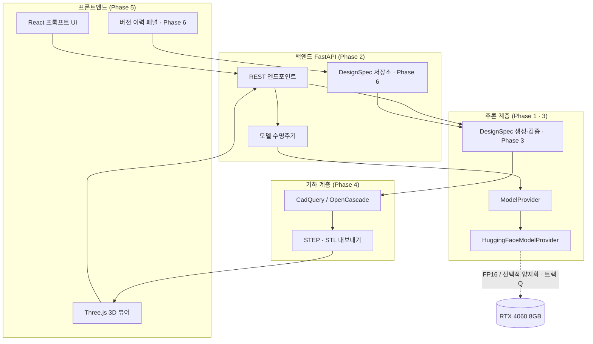
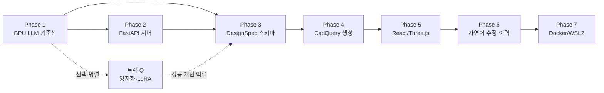

# Local AI CAD — 전체 단계 로드맵

- 상태: 전체 단계 설계 확정. **Phase 1~6 완료(2026-10-14)**. Phase 7 패키징과 선택 트랙 Q가 남음
- 기준일: 2026-10-14
- 관계: 이 문서는 전체 단계의 상위 설계다. Phase 1의 상세 설계는 `docs/phase-1-design.md`에 있고, 이후 각 Phase는 착수 시점에 `docs/phase-N-design.md`를 따로 작성한다.

---

## 1. 제품 정의

자연어로 말하면 로컬 LLM이 설계 명세를 만들고, 그 명세로 실제 CAD 파일(STEP/STL)을 생성해 브라우저에서 보여주는 데스크톱 애플리케이션이다.

핵심 제약 하나가 전체 설계를 지배한다.

> **외부 LLM API를 쓰지 않는다.** 모든 추론은 이 PC의 GPU에서 실행한다.

이 제약 때문에 "모델이 돌아가는가"를 가장 먼저, 가장 엄격하게 검증한다. 그게 Phase 1이다.

### 최종 사용자 시나리오

```
사용자: "가로 120cm, 깊이 60cm 책상 만들어줘. 다리는 4개."
  → LLM이 DesignSpec JSON 생성
  → CadQuery가 JSON을 3D 솔리드로 변환
  → 브라우저에 3D 뷰 표시 + STEP/STL 다운로드

사용자: "다리를 좀 더 두껍게."
  → 기존 DesignSpec을 수정 → 재생성 → 버전 기록
```

---

## 2. 측정된 실행 환경

아래는 2026-10-14에 이 머신에서 **직접 측정한 값**이다.

| 항목 | 측정값 | 측정 방법 |
|---|---|---|
| 운영체제 | Windows 11 Pro, x64 | 시스템 정보 |
| GPU | NVIDIA GeForce RTX 4060 | `nvidia-smi` |
| 전용 VRAM | 8,188 MiB | `nvidia-smi` |
| 측정 시 VRAM 사용량 | 782 MiB | `nvidia-smi` |
| NVIDIA 드라이버 | 591.86 | `nvidia-smi` |
| 드라이버 CUDA 상한 | 13.1 | `nvidia-smi` |
| Python | **설치 안 됨** | `where python` → Store 별칭 스텁만 존재 |
| Miniforge/conda | **없음** | `where conda` 실패, `~/miniforge3` 부재 |
| Node.js / npm | 24.18.0 / 11.16.0 | `node -v`, `npm -v` |
| Git | 2.54.0.windows.1 | `git --version` |
| GitHub CLI | **설치 안 됨** | `gh --version` 실패 |
| C: 여유 공간 | **32 GB** (465GB 중 433GB 사용, 94%) | `df -h /c` |
| 원격 저장소 | `https://github.com/jngbnss/local-ai-cad.git` (`main` 추적 중) | `git remote -v` |
| 저장소 내용물 | `docs/phase-1-design.md` 1개 | `git ls-files` |

### `phase-1-design.md`와의 불일치

Phase 1 설계서 §2 표는 다른 머신 기준으로 작성된 것으로 보인다. 차이가 큰 항목:

| 항목 | 설계서 기재 | 실측 | 영향 |
|---|---|---|---|
| GPU | RTX 4050 Laptop | RTX 4060 | VRAM 여유 **증가**, OOM 위험 감소 |
| VRAM | 6,141 MiB | 8,188 MiB | 생성 길이·배치 여유 증가 |
| C: 여유 공간 | 약 510 GB | **32 GB** | **디스크 예산이 제약 조건으로 승격** |
| Python | 3.12.12 설치됨 | 없음 | Phase 1 첫 작업이 Python 설치로 확정 |
| GitHub CLI | 2.102.0 | 없음 | 저장소 작업은 `git` + 웹 UI로 수행 |

설계서 §2는 실측값으로 정정했다. **디스크 32GB는 이 프로젝트의 가장 빡빡한 자원**이며 §8 예산표에서 따로 관리한다.

---

## 3. 최종 아키텍처

모든 Phase가 끝났을 때의 모습이다. 각 Phase는 이 그림의 일부를 채운다.



---

## 4. 단계 의존 그래프



직렬 경로는 **1 → 2 → 3 → 4 → 5 → 6 → 7** 이다. 트랙 Q(양자화·파인튜닝)만 Phase 1 완료 후 언제든 병렬로 돌릴 수 있는 선택 트랙이다.

> Phase 번호는 `phase-1-design.md`가 이미 고정한 값(Phase 2 = FastAPI, Phase 7 = Docker/WSL2)을 따른다. 양자화·LoRA는 설계서 §14에 비범위로만 적혀 있고 번호가 없으므로 번호를 새로 발명하지 않고 **트랙 Q**로 둔다.

---

## 5. 단계별 설계

각 Phase는 **진입 조건 → 완료 기준 → 산출물** 순으로 읽는다. 완료 기준은 전부 관찰 가능한 사실로 적는다. "구현했다"는 완료가 아니고 "실행해서 결과를 봤다"가 완료다.

### Phase 1 — 로컬 GPU LLM 기준선

| | |
|---|---|
| **목표** | RTX 4060에서 Qwen2.5-1.5B-Instruct를 FP16으로 로드하고 한국어 추론 1회를 성공시키며 성능을 측정한다 |
| **진입 조건** | 없음 (시작 단계) |
| **상세 설계** | `docs/phase-1-design.md` |

완료 기준:

1. Python 3.11 `.venv`에서 실행되고 `python`·`pip` 출처가 `.venv` 내부다.
2. `torch.cuda.is_available() == True`이고 장치명이 `NVIDIA GeForce RTX 4060`이다.
3. 모델이 프로세스당 1회만 로드된다 (두 번째 요청에서 재로드 없음).
4. 한국어 프롬프트에 실제 생성 텍스트가 나오고 종료 코드가 0이다.
5. `load_seconds`, `inference_seconds`, `input_tokens`, `output_tokens`, `peak_vram_mib`가 구조화 로그에 남는다.
6. Mock provider 결과는 `provider: "mock"`으로 구분되어 성능 보고에서 제외된다.
7. CUDA 미인식·OOM·모델 다운로드 실패가 서로 다른 조치 가능 메시지로 구분된다.

산출물: `pyproject.toml`, `requirements.lock`, `.env.example`, `.gitignore`, `backend/app/config.py`, `backend/app/ai/{cli,diagnostics,metrics,providers}.py`, `backend/tests/*`, `README.md`

비범위: 웹 계층 일체. 웹을 끼우면 GPU 실패와 API 설정 실패를 분리할 수 없다.

리스크: Python 미설치 상태라 환경 구축이 첫 작업이다 / 디스크 32GB에서 torch CUDA 휠 + 모델 캐시가 약 7GB를 쓴다.

---

### Phase 2 — FastAPI 서버와 모델 수명주기

| | |
|---|---|
| **목표** | Phase 1의 provider를 장수명 HTTP 서버에 붙여 프로세스 1개가 모델 1개를 소유하게 만든다 |
| **진입 조건** | Phase 1 완료 보고서에 실측 성능값이 존재 |

완료 기준:

1. 서버 기동 시 모델을 1회 로드하고(lifespan), 종료 시 VRAM을 해제한다.
2. `GET /api/v1/health`가 모델 적재 상태·장치·dtype을 반환한다.
3. `POST /api/v1/generate`가 프롬프트를 받아 생성 텍스트와 Phase 1 측정 필드를 함께 반환한다.
4. 동시 요청 2개를 보내면 추론 lock으로 **직렬 처리**되고 OOM이 발생하지 않는다.
5. 요청별 `request_id`가 로그와 응답에 함께 남는다.
6. 서버를 띄운 채 10회 연속 요청해도 모델 재로드가 0회다.

산출물: `backend/app/main.py`, `backend/app/api/v1/*.py`, `backend/app/deps.py`, 요청/응답 Pydantic 모델, API 통합 테스트

핵심 결정:
- 워커 1개 고정. uvicorn 멀티워커는 모델을 프로세스 수만큼 복제하므로 **금지**한다.
- 생성은 동기 blocking이 아니라 스레드 풀에 위임해 이벤트 루프를 막지 않는다.
- 스트리밍(SSE)은 Phase 5에서 UI가 필요해질 때 추가한다. 여기서는 단일 응답만.

비범위: 인증, 다중 사용자, CAD 로직, 프론트엔드.

리스크: lifespan 안에서 모델 로드가 수십 초 걸려 헬스체크 타임아웃 → `health`는 "로딩 중" 상태를 명시적으로 반환해야 한다.

---

### Phase 3 — DesignSpec 스키마와 프롬프트

| | |
|---|---|
| **목표** | 자유 텍스트 출력이 아니라 **검증 가능한 JSON**을 LLM에게서 안정적으로 받아낸다 |
| **진입 조건** | Phase 2의 `/generate`가 동작 |

이 단계가 프로젝트에서 가장 실패하기 쉬운 지점이다. 1.5B 모델은 JSON 스키마 준수가 약하다. 따라서 "프롬프트를 잘 쓴다"에 기대지 않고 **문법 제약 디코딩 또는 재시도 + 검증 루프**를 설계에 포함한다.

완료 기준:

1. `DesignSpec` Pydantic 모델이 정의되고 치수·단위·부품 관계 제약을 검증한다.
2. 한국어 프롬프트 20개 고정 평가셋에서 **스키마 유효 JSON 산출률이 측정되어 기록**된다.
3. 유효하지 않은 출력은 최대 N회 재시도 후 명시적 실패로 보고된다 (조용한 기본값 채우기 **금지**).
4. 단위는 내부적으로 **mm 단일 단위**로 정규화된다. `120cm` 입력이 `1200` mm로 저장된다.
5. 물리적으로 불가능한 명세(음수 치수, 다리가 상판보다 긴 경우 등)가 검증에서 걸린다.
6. 프롬프트 템플릿과 few-shot 예제가 코드가 아닌 파일로 분리된다.

산출물: `backend/app/design/schema.py`, `backend/app/design/prompt.py`, `backend/app/design/validator.py`, `datasets/eval_prompts.jsonl`, `experiments/spec_accuracy_report.md`

핵심 결정:
- 산출률이 목표치에 못 미치면 → 트랙 Q(파인튜닝) 또는 더 큰 모델로 분기한다. **이 분기 판단은 측정값으로만 한다.**
- 스키마는 Phase 4 CadQuery가 **그대로 소비 가능한 형태**로 설계한다. 중간 변환 계층을 만들지 않는다.

비범위: 어셈블리 구속조건, 파라메트릭 수식, 재질·물성.

리스크: 1.5B 모델의 JSON 준수율이 낮아 Phase 4 진입이 막힐 수 있다 → 완료 기준 2번이 조기 경보 역할을 한다.

---

### Phase 4 — CadQuery 기하 생성과 파일 내보내기

| | |
|---|---|
| **목표** | DesignSpec JSON을 실제 3D 솔리드로 만들고 STEP/STL로 내보낸다 |
| **진입 조건** | Phase 3의 스키마 확정 및 유효 JSON 산출 확인 |

완료 기준:

1. `DesignSpec` → CadQuery 솔리드 변환기가 동작한다.
2. 생성된 솔리드가 **유효성 검사를 통과**한다 (닫힌 솔리드, 0이 아닌 부피).
3. STEP과 STL 파일이 디스크에 생성되고 외부 뷰어에서 열린다.
4. 명세의 치수와 생성물의 바운딩 박스가 허용 오차 내에서 일치한다 — **치수 검증 테스트**.
5. 기하 생성 실패(불리언 연산 실패 등)가 LLM 실패와 분리된 오류로 보고된다.
6. `POST /api/v1/design`이 프롬프트 → DesignSpec → CAD 파일까지 한 번에 수행한다.

산출물: `backend/app/cad/builder.py`, `backend/app/cad/exporter.py`, `backend/app/cad/validate.py`, `backend/tests/test_cad_dimensions.py`, 생성물 저장 디렉터리 규약

핵심 결정:
- CadQuery는 OpenCascade 네이티브 바이너리를 끌고 온다. **Python 3.11을 고른 이유가 이것**이므로 여기서 설치 호환성을 최종 확인한다.
- LLM이 생성한 Python 코드를 `exec`하지 **않는다**. 선언적 DesignSpec → 우리 코드가 CadQuery 호출. 임의 코드 실행은 보안·재현성 양쪽에서 실격이다.
- 지원 형상은 처음에 박스·실린더·불리언 조합으로 한정하고 측정 후 확장한다.

비범위: 스케치 기반 자유 곡면, 어셈블리 간섭 검사, 도면(2D) 출력.

리스크: OpenCascade 설치 용량(약 1.5GB)이 디스크 예산을 압박한다 / 불리언 연산 실패는 흔하므로 완료 기준 5번이 필수다.

---

### Phase 5 — React · Three.js 프론트엔드

| | |
|---|---|
| **목표** | 브라우저에서 프롬프트를 입력하고 결과 3D 모델을 눈으로 본다 |
| **진입 조건** | Phase 4가 STL을 반환 |

완료 기준:

1. 프롬프트 입력 → 로딩 상태 → 3D 렌더 → 파일 다운로드의 전체 흐름이 브라우저에서 동작한다.
2. Three.js가 백엔드 STL을 로드해 회전·확대·축소가 된다.
3. 생성 중 진행 상태(LLM 생성 / 기하 생성)가 단계별로 표시된다.
4. 백엔드 오류가 사용자에게 **원인별로 다른 메시지**로 전달된다 (OOM ≠ 스키마 실패 ≠ 기하 실패).
5. 측정값(추론 시간, 생성 시간)이 UI에 노출된다 — 성능 퇴행을 눈으로 잡기 위함.
6. 실제 브라우저 실행 스크린샷이 검증 증거로 남는다.

산출물: `frontend/` (Vite + React + TypeScript), `frontend/src/components/Viewer.tsx`, API 클라이언트, 개발용 프록시 설정

핵심 결정:
- 뷰어 포맷은 **STL**(렌더용)과 **STEP**(다운로드용)을 분리한다. STEP은 브라우저에서 직접 렌더하기 어렵다.
- 긴 생성 시간 때문에 여기서 SSE 스트리밍 진행 상태를 도입한다.

비범위: 인증, 다중 프로젝트, 모바일 레이아웃.

리스크: `node_modules`가 디스크 예산을 추가로 먹는다 (약 0.5GB).

---

### Phase 6 — 자연어 수정과 버전 이력

| | |
|---|---|
| **목표** | "다리를 더 두껍게" 같은 후속 지시로 기존 설계를 수정하고 되돌릴 수 있다 |
| **진입 조건** | Phase 5에서 생성 흐름이 완결 |

완료 기준:

1. 기존 DesignSpec + 수정 지시 → 새 DesignSpec을 생성하는 경로가 동작한다.
2. 수정 결과가 **전체 재생성이 아니라 diff로 기록**된다. 어떤 필드가 변경됐는지 조회 가능하다.
3. 버전 N으로 되돌리면 그 시점의 CAD 파일이 복원된다.
4. 수정 지시가 기존 명세를 **의도치 않게 파괴하지 않는지** 검증한다 (언급 없는 필드 보존 테스트).
5. 이력이 프로세스 재시작 후에도 유지된다 (SQLite 영속화).

산출물: `backend/app/design/history.py`, SQLite 스키마와 마이그레이션, `frontend/src/components/HistoryPanel.tsx`

핵심 결정:
- 저장 단위는 **DesignSpec JSON**이다. CAD 바이너리는 재생성 가능하므로 캐시로 취급한다 — 디스크 32GB 제약에 직접 대응.
- 수정은 "전체 재생성 후 비교"가 아니라 "기존 스펙을 컨텍스트로 준 부분 수정"으로 설계한다. 1.5B 모델에게 매번 전체를 다시 쓰게 하면 보존성이 무너진다.

비범위: 브랜칭·머지, 다중 사용자 동시 편집.

리스크: 작은 모델이 "언급 안 한 필드 보존"에 약하다 → 완료 기준 4번이 핵심 방어선이다.

---

### Phase 7 — Docker · WSL2 GPU 패키징

| | |
|---|---|
| **목표** | 다른 머신에서도 동일하게 재현되도록 컨테이너화한다 |
| **진입 조건** | Phase 6까지 Windows 호스트에서 동작 확인 |

완료 기준:

1. WSL2 + NVIDIA Container Toolkit으로 컨테이너 안에서 `torch.cuda.is_available() == True`.
2. `docker compose up` 한 번으로 백엔드·프론트엔드가 뜬다.
3. 컨테이너 내부 추론 성능이 Windows 호스트 대비 **측정되어 기록**된다 (저하 폭 명시).
4. 모델 캐시가 볼륨으로 분리되어 이미지에 가중치가 포함되지 않는다.
5. 이미지 크기가 기록된다.

산출물: `docker/Dockerfile.backend`, `docker/Dockerfile.frontend`, `docker-compose.yml`, `docs/phase-7-design.md`

리스크: **디스크 32GB에서 Docker 이미지 빌드가 불가능할 수 있다.** 이 Phase 착수 전 디스크 확보가 선행 조건이다.

---

### 트랙 Q — 양자화와 파인튜닝 (선택 · 병렬)

| | |
|---|---|
| **목표** | FP16 기준선 대비 속도·메모리·정확도를 개선한다 |
| **진입 조건** | Phase 1의 FP16 기준선 측정값 확보 |

이건 단계가 아니라 **실험 트랙**이다. 언제 할지는 Phase 3의 JSON 산출률 측정 결과가 결정한다.

- 산출률이 충분 → 트랙 Q 생략 가능
- 산출률이 부족 → 트랙 Q가 **필수 경로로 승격**

실험 항목:

1. 4-bit 양자화(bitsandbytes) — Windows 설치 안정성이 선행 검증 대상
2. 더 큰 모델(7B급) 적재 가능성 — **8GB VRAM과 32GB 디스크로는 어려움**, 측정으로 판단
3. DesignSpec 생성 LoRA 파인튜닝 — `datasets/`에 학습셋 구축 선행

완료 기준: 각 실험마다 FP16 기준선과 동일 조건에서 추론 시간·peak VRAM·JSON 유효율을 비교한 보고서가 `experiments/`에 남는다.

---

## 6. 단계 간 데이터 계약

Phase 경계를 넘는 자료 구조를 미리 고정한다. 이게 흔들리면 뒤 단계가 전부 흔들린다.

### DesignSpec (Phase 3 정의 → Phase 4·6 소비)

```json
{
  "schema_version": "1.0",
  "unit": "mm",
  "name": "desk",
  "parts": [
    {
      "id": "top",
      "primitive": "box",
      "dimensions": { "x": 1200, "y": 600, "z": 25 },
      "position": { "x": 0, "y": 0, "z": 725 }
    },
    {
      "id": "leg_fl",
      "primitive": "box",
      "dimensions": { "x": 50, "y": 50, "z": 725 },
      "position": { "x": -550, "y": -250, "z": 0 }
    }
  ],
  "operations": [
    { "type": "union", "targets": ["top", "leg_fl"] }
  ]
}
```

불변 규칙:

- `unit`은 항상 `mm`. 사용자 입력의 cm·inch는 Phase 3 진입 시점에 정규화한다.
- `id`는 Phase 6의 수정 지시가 부품을 지목하는 핸들이다. 재생성해도 **안정적으로 유지**해야 한다.
- `schema_version`은 Phase 6 이력 호환성의 근거다. 처음부터 넣는다.

### REST 계약 (Phase 2 정의 → Phase 5 소비)

| 메서드 | 경로 | 입력 | 출력 |
|---|---|---|---|
| `GET` | `/api/v1/health` | — | 모델 적재 상태, 장치, dtype |
| `POST` | `/api/v1/generate` | `{prompt}` | 생성 텍스트 + 측정 필드 |
| `POST` | `/api/v1/design` | `{prompt}` | `DesignSpec` + 아티팩트 ID |
| `POST` | `/api/v1/design/{id}/revise` | `{instruction}` | 새 버전 `DesignSpec` + diff |
| `GET` | `/api/v1/artifacts/{id}.{stl\|step}` | — | 바이너리 |
| `GET` | `/api/v1/design/{id}/history` | — | 버전 목록 |

모든 응답은 Phase 1의 측정 필드를 포함한다. 성능 퇴행을 단계가 올라가도 계속 추적하기 위함이다.

---

## 7. 공통 설계 원칙

모든 Phase에 적용되며, 위반하면 해당 Phase는 미완료다.

1. **측정 없이 완료 없음.** 단위 테스트 통과는 완료가 아니다. 실제 실행 관측값이 있어야 한다.
2. **조용한 폴백 금지.** CPU 폴백, 기본값 자동 채우기, 예외 삼키기 전부 금지. 실패는 실패로 보고한다.
3. **오류 경계 분리.** 환경 오류 / 모델 오류 / 스키마 오류 / 기하 오류는 서로 다른 메시지를 낸다. 합치면 디버깅이 불가능해진다.
4. **LLM 생성 코드 실행 금지.** LLM은 데이터(JSON)만 만든다. 실행 코드는 우리가 쓴다.
5. **가중치·캐시·빌드 산출물은 Git 제외.** 저장소에는 코드와 문서와 lock 파일만.
6. **상위 의존성 버전 고정.** 무제한 범위 금지, lock 파일 커밋.
7. **Phase 진입 조건 미충족 시 진행 금지.** 앞 단계 실패를 뒤 단계 구현으로 덮지 않는다.

---

## 8. 자원 예산

### VRAM (8,188 MiB)

| 소비자 | 추정 | 비고 |
|---|---|---|
| 데스크톱·브라우저 | 약 780 MiB | 실측 |
| Qwen2.5-1.5B FP16 가중치 | 약 3,100 MiB | 1.54B × 2 bytes |
| KV 캐시·활성화 | 약 500–1,000 MiB | 생성 길이 의존 |
| **합계** | **약 4.4–4.9 GB** | 여유 약 3.3 GB |

여유가 있으므로 Phase 1의 "생성 길이 256" 제한은 측정 후 완화 가능하다. 단 동시 실행 1개 원칙은 유지한다.

### 디스크 (여유 32 GB — **최대 제약**)

| 소비자 | 추정 |
|---|---|
| Python 3.11 + `.venv` 기본 | 약 0.3 GB |
| PyTorch CUDA 휠 + 의존성 | 약 3.5 GB |
| Qwen2.5-1.5B 가중치 캐시 | 약 3.1 GB |
| transformers·accelerate 등 | 약 0.5 GB |
| CadQuery + OpenCascade (Phase 4) | 약 1.5 GB |
| `node_modules` (Phase 5) | 약 0.5 GB |
| 생성 아티팩트·이력 DB | 약 0.5 GB |
| **Phase 1–6 합계** | **약 9.9 GB** |
| Docker 이미지·빌드 캐시 (Phase 7) | **10 GB 이상** |

판단:

- Phase 1–6은 32 GB 안에서 **수행 가능**하다.
- **Phase 7 착수 전 디스크 확보가 필수**다. 현재 여유로는 이미지 빌드가 실패할 가능성이 높다.
- 7B급 모델(FP16 약 15 GB)은 **현재 디스크로 불가능**하다. 트랙 Q의 모델 확대 실험은 디스크 확보가 선행 조건이다.
- Hugging Face 캐시 경로를 `LOCAL_AI_CAD_HF_HOME`으로 다른 드라이브에 옮길 수 있게 한 Phase 1 설계는 이 제약에서 **옳은 결정**이다.

---

## 9. 전체 리스크 등록부

| 리스크 | 영향 Phase | 영향 | 대응 |
|---|---|---|---|
| C: 여유 32 GB | 1 · 4 · 7 | 설치·빌드 실패 | 예산표 관리, 캐시 경로 외부화, Phase 7 전 확보 |
| 1.5B 모델의 JSON 스키마 준수율 부족 | 3 | 파이프라인 전체 정지 | 평가셋으로 조기 측정, 미달 시 트랙 Q 승격 |
| Windows에서 CadQuery/OCC 설치 실패 | 4 | 기하 계층 불가 | Python 3.11 고정, Phase 4 착수 즉시 설치 검증 |
| 수정 지시가 기존 명세 파괴 | 6 | 사용성 붕괴 | 필드 보존 테스트, diff 기반 기록 |
| Windows에서 bitsandbytes 불안정 | 트랙 Q | 양자화 실험 불가 | 선택 트랙으로 격리, 실패해도 본선 무영향 |
| 멀티워커로 모델 중복 적재 | 2 | OOM | 워커 1개 고정을 설계에 명시 |
| 단계가 올라가며 추론 성능 퇴행 | 2–6 | 사용성 저하 | 모든 응답에 측정 필드 유지 |

---

## 10. 지금 시점의 결론

- 전체는 **7단계 + 선택 트랙 1개**다. 직렬 경로는 1→2→3→4→5→6→7.
- 현재 진행률: **Phase 1 완료**. 로컬 GPU LLM 기준선 실측 완료 — 측정값은 `README.md` "Phase 1 완료 보고".
- 다음 작업은 **Phase 2 (FastAPI 서버와 모델 수명주기)** 다. 착수 시 `docs/phase-2-design.md` 를 먼저 작성한다.
- 가장 큰 미해결 리스크 2개: **디스크 여유 24 GB**(Phase 1에서 torch 휠 + 모델 캐시로 약 8 GB 소비)와 **1.5B 모델의 JSON 산출률**(Phase 3에서 측정으로 판정).
- Phase 1에서 드러난 새 리스크: 브라우저·Electron 앱이 VRAM을 5 GiB 넘게 점유하면 모델 로드가 OOM으로 실패한다. 실제 발생했고 종료 코드 5로 분리 보고된다.
