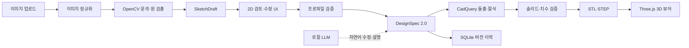
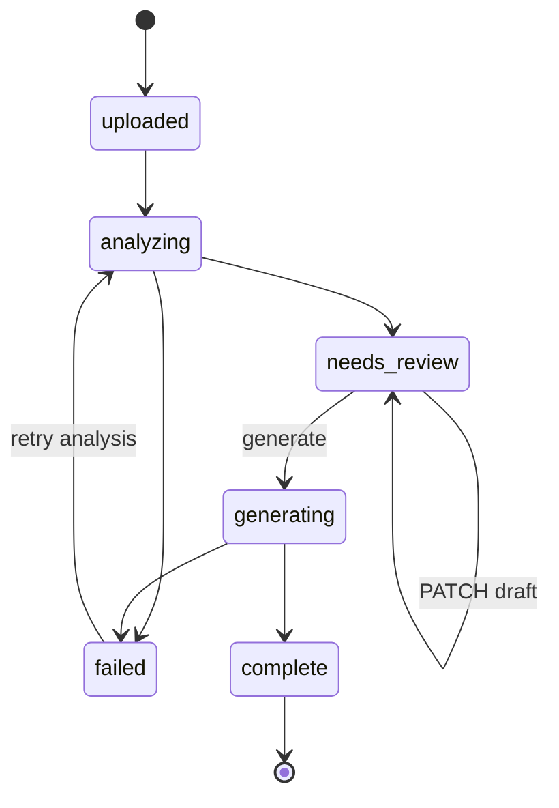

# Track D — 2D 도면 이미지에서 3D CAD 생성 설계

- 상태: 구현 전 설계
- 우선순위: 사진 추정보다 먼저 구현
- 목표 입력: 치수가 있거나 기준 길이를 지정할 수 있는 정면 2D 도면 이미지
- 목표 출력: 사용자가 확인한 2D 프로파일, 유효한 3D 솔리드, STL/STEP
- 기존 기반: Phase 1~6의 로컬 LLM, FastAPI, CadQuery, React/Three.js, SQLite 이력

## 1. 문제와 결정

현재 제품은 자연어를 `DesignSpec 1.0`의 box/cylinder 조합으로 바꿔 3D CAD를 만든다. 이미지 업로드, 2D 스케치, 임의 폐곡선 돌출은 지원하지 않는다.

Track D의 첫 릴리스는 **일반 제품 사진 복원**이 아니라 다음 흐름으로 한정한다.

1. 사용자가 깨끗한 정면 도면 PNG/JPEG를 업로드한다.
2. 시스템이 외곽선과 관통 구멍 후보를 추출한다.
3. 사용자가 기준 길이와 돌출 깊이를 입력하고 결과를 확인·수정한다.
4. 확인된 프로파일을 CadQuery로 돌출하고 구멍을 절삭한다.
5. 기존 3D 뷰어, STL/STEP 다운로드, 버전 이력을 재사용한다.

일반 사진 한 장은 보이지 않는 뒷면과 절대 치수를 결정할 수 없다. 이를 자동 CAD 변환으로 표시하면 거짓 정밀도가 된다. 사진 입력은 Track D 완료 후 별도 Track V에서 다룬다.

## 2. MVP 범위

### 지원

- PNG, JPEG, WebP 래스터 이미지
- 최대 10 MiB, 디코딩 후 최대 4096×4096 픽셀
- 흰 배경/어두운 선 또는 그 반대인 단일 정면도
- 하나의 닫힌 외곽 프로파일
- 0개 이상의 원형 또는 다각형 관통 구멍
- 사용자가 지정하는 한 개의 기준 선분과 실제 길이(mm)
- 사용자가 지정하는 돌출 깊이(mm)
- 직선 기반 외곽선과 원
- 프로파일 점 이동, 점 추가·삭제, 구멍 추가·삭제
- 2D 오버레이 확인 후 명시적 생성
- STL/STEP 출력과 기존 3D 이력

### 비범위

- 일반 제품 사진 한 장에서 정확한 치수 추정
- 정면·측면·평면도의 자동 대응
- 투시 왜곡이 큰 사진, 그림자, 복잡한 배경
- 자유곡선, 스플라인, 필렛, 챔퍼, 나사산
- 여러 깊이를 가진 포켓과 단계 형상
- 숨은선에서 형상 추론
- OCR 결과만 믿고 사용자 확인 없이 CAD 생성
- DXF 편집기나 범용 AutoCAD 대체

## 3. 사용자 완료 시나리오

1. 사용자가 `plate.png`를 드롭한다.
2. UI가 파일 형식과 크기를 검사해 업로드한다.
3. 백엔드가 이미지를 정규화하고 외곽선·구멍 후보를 계산한다.
4. UI가 원본 위에 검출 오버레이를 표시한다.
5. 사용자가 도면의 두 점을 찍고 `100 mm`라고 입력한다.
6. 사용자가 돌출 깊이 `8 mm`를 입력한다.
7. 잘못 잡힌 점이나 구멍이 있으면 직접 수정한다.
8. UI가 실제 예상 크기와 경고를 보여준다.
9. 사용자가 `3D 생성`을 누른다.
10. 백엔드가 프로파일 유효성 검사 → 돌출 → 관통 절삭 → 솔리드 검증 → STL/STEP 내보내기를 수행한다.
11. 기존 Three.js 뷰어가 STL을 보여주고 STEP을 다운로드할 수 있다.
12. 이후 명시적 치수 편집은 새 설계 버전으로 기록된다.

## 4. 아키텍처



핵심 분리:

- 픽셀 검출은 OpenCV가 담당한다. LLM에 픽셀 좌표를 생성시키지 않는다.
- 실제 치수는 사용자 기준 길이로 보정한다. 사진만 보고 mm를 추측하지 않는다.
- LLM은 확인된 구조의 이름 지정과 후속 자연어 수정에만 사용한다.
- 이미지 분석 실패와 LLM 실패, 기하 실패를 각각 다른 오류로 보고한다.

## 5. 좌표계와 단위

세 좌표계를 섞지 않는다.

| 좌표계 | 원점 | 축 | 단위 |
|---|---|---|---|
| 이미지 | 좌상단 | x 오른쪽, y 아래 | px |
| 스케치 | 기준점 또는 외곽 바운딩 박스 중심 | x 오른쪽, y 위 | mm |
| CAD | 스케치 원점 | x 오른쪽, y 위, z 돌출 방향 | mm |

보정값:

```text
mm_per_px = reference_length_mm / pixel_distance(reference_start, reference_end)
```

변환:

```text
x_mm = (x_px - origin_x_px) * mm_per_px
y_mm = (origin_y_px - y_px) * mm_per_px
```

불변 규칙:

- 내부 단위는 항상 mm다.
- `mm_per_px`는 유한한 양수여야 한다.
- 기준 선분은 최소 20px 이상이어야 한다.
- 실제 길이는 0.1~10,000mm 범위다.
- 돌출 깊이는 0.1~10,000mm 범위다.
- 생성 후 CAD 바운딩 박스 x/y는 스케치 외곽 크기, z는 돌출 깊이와 허용 오차 내에서 일치해야 한다.

## 6. 데이터 계약

### 6.1 SketchDraft

분석 결과는 바로 CAD로 보내지 않고 수정 가능한 초안으로 저장한다.

```json
{
  "schema_version": "1.0",
  "import_id": "8f7a3c21",
  "revision": 3,
  "image": {
    "width_px": 1600,
    "height_px": 1200,
    "normalized_artifact": "/api/v1/imports/8f7a3c21/image"
  },
  "calibration": {
    "start_px": [210.0, 1020.0],
    "end_px": [1390.0, 1020.0],
    "length_mm": 100.0,
    "mm_per_px": 0.08474576
  },
  "origin_px": [800.0, 600.0],
  "outer": {
    "id": "outer",
    "kind": "polygon",
    "points_px": [[210.0, 220.0], [1390.0, 220.0], [1390.0, 980.0], [210.0, 980.0]],
    "confidence": 0.99,
    "source": "detected"
  },
  "holes": [
    {
      "id": "hole_1",
      "kind": "circle",
      "center_px": [500.0, 600.0],
      "radius_px": 60.0,
      "confidence": 0.94,
      "source": "detected"
    }
  ],
  "extrusion_depth_mm": 8.0,
  "warnings": [],
  "status": "needs_review"
}
```

규칙:

- `revision`은 낙관적 동시성 제어용이다. PATCH가 현재 revision과 다르면 `409 draft_conflict`다.
- `source`는 `detected` 또는 `user`다. 사용자가 고친 값은 재분석으로 덮어쓰지 않는다.
- confidence는 UI 표시용이며 유효성 판정의 대체물이 아니다.
- 보정값과 깊이가 없으면 상태는 `needs_review`이고 CAD 생성은 거부한다.

### 6.2 DesignSpec 2.0

현재 `Dimensions`에 nullable 필드를 계속 추가하지 않는다. `Part`를 primitive별 판별 공용체로 바꾸고 `sketch_extrusion`을 추가한다.

```json
{
  "schema_version": "2.0",
  "unit": "mm",
  "name": "imported_plate",
  "parts": [
    {
      "id": "body",
      "primitive": "sketch_extrusion",
      "profile": {
        "outer": [[-50.0, -32.2], [50.0, -32.2], [50.0, 32.2], [-50.0, 32.2]],
        "holes": [
          {"kind": "circle", "center": [-25.4, 0.0], "radius": 5.08}
        ]
      },
      "depth": 8.0,
      "position": {"x": 0.0, "y": 0.0, "z": 0.0}
    }
  ],
  "operations": [],
  "source": {"kind": "drawing_import", "import_id": "8f7a3c21"}
}
```

마이그레이션 원칙:

- `box`, `cylinder`, `sketch_extrusion`을 각각 독립 Pydantic 모델로 정의한다.
- 모든 신규 저장은 `schema_version: "2.0"`을 쓴다.
- 기존 SQLite의 1.0 JSON은 일회성 DB 마이그레이션으로 2.0 형태로 변환한다.
- 백엔드, 프론트엔드 TypeScript 타입, 프롬프트, builder, diff, 테스트를 한 커밋 범위에서 함께 전환한다.
- 1.0/2.0 런타임 이중 경로를 장기간 유지하지 않는다.

## 7. 이미지 처리 파이프라인

### 7.1 업로드 검증

1. 확장자가 아니라 실제 magic bytes와 디코더 결과를 확인한다.
2. EXIF 방향을 적용한 뒤 EXIF 메타데이터를 제거한다.
3. 픽셀 수와 디코딩 후 메모리 상한을 검사한다.
4. 사용자 파일명을 저장 경로에 사용하지 않는다.
5. 무작위 `import_id` 아래에 정규화 PNG로 저장한다.
6. 원본과 정규화 파일은 웹 정적 루트 밖에 둔다.

오류:

- `unsupported_image`
- `image_too_large`
- `image_decode_failed`
- `image_dimensions_invalid`

### 7.2 정규화

1. EXIF 방향 적용
2. 알파 채널을 흰색에 합성
3. grayscale 변환
4. 긴 변이 2048px를 넘으면 분석 사본만 축소
5. 대비 정규화
6. Otsu 또는 adaptive threshold 후보 생성
7. 선이 흰색이 되도록 극성 통일
8. 작은 노이즈만 morphology open으로 제거

원본 좌표와 분석 좌표 사이의 scale을 기록해 결과를 원본 좌표로 되돌린다.

### 7.3 외곽선 검출

1. `findContours(RETR_TREE)`로 contour와 포함 관계를 얻는다.
2. 최소 면적·둘레 미만 후보를 제거한다.
3. 이미지 테두리와 일치하는 프레임을 제거한다.
4. `approxPolyDP`로 직선 기반 프로파일을 단순화한다.
5. 가장 큰 유효 폐곡선을 outer 후보로 선택한다.
6. outer 내부 contour를 hole 후보로 분류한다.
7. 원형도와 `HoughCircles` 결과가 합의하면 circle로 저장한다.
8. 나머지 닫힌 구멍은 polygon으로 저장한다.

자동 선택이 애매하면 임의로 하나를 확정하지 않고 후보와 `ambiguous_outer` 경고를 UI에 보낸다.

### 7.4 프로파일 유효성

CAD 생성 전에 다음을 모두 검사한다.

- outer는 점 3개 이상의 단순 폐곡선
- 연속 중복점과 길이 0인 edge 없음
- self-intersection 없음
- 면적이 0보다 큼
- 모든 hole이 outer 내부에 있음
- hole이 outer 경계와 교차하지 않음
- hole끼리 교차하지 않음
- circle radius가 양수
- 최소 edge와 최소 간격이 0.1mm 이상
- 전체 크기가 10,000mm 이하

검사 실패 시 자동으로 점을 이동하거나 구멍을 삭제하지 않는다. 문제 entity와 좌표를 반환한다.

## 8. CAD 변환

`sketch_extrusion` 변환 순서:

1. XY workplane에 outer polygon을 그려 닫는다.
2. outer를 `depth`만큼 +Z로 extrude한다.
3. polygon hole은 별도 wire로 만들고 전체 깊이로 cut한다.
4. circle hole은 중심과 반지름으로 원통 cut을 수행한다.
5. 결과가 단일 solid인지 확인한다.
6. 유효성, 부피, 바운딩 박스를 검사한다.
7. STL과 STEP을 내보낸다.

실패 경계:

- `profile_invalid`: 입력 토폴로지 오류
- `calibration_missing`: 기준 길이 없음
- `depth_missing`: 돌출 깊이 없음
- `sketch_build_failed`: wire 생성 실패
- `geometry_failed`: 돌출/절삭 실패
- `geometry_invalid`: 닫힌 단일 solid가 아님
- `dimension_mismatch`: 결과 치수가 스펙과 허용 오차 밖
- `export_failed`: STL/STEP 저장 실패

## 9. REST API

기존 `/api/v1/design`은 텍스트 생성용으로 유지한다. 이미지 흐름은 job 리소스로 분리한다.

| 메서드 | 경로 | 입력 | 출력 |
|---|---|---|---|
| `POST` | `/api/v1/imports` | multipart `image` | `202`, import ID와 상태 |
| `GET` | `/api/v1/imports/{id}` | — | 상태, SketchDraft, 경고 |
| `GET` | `/api/v1/imports/{id}/image` | — | 정규화 PNG |
| `GET` | `/api/v1/imports/{id}/events` | — | 분석 단계 SSE |
| `PATCH` | `/api/v1/imports/{id}/draft` | revision + 수정된 draft 필드 | 갱신된 draft |
| `POST` | `/api/v1/imports/{id}/generate` | revision + 이름 | 기존 형식의 DesignResponse |
| `DELETE` | `/api/v1/imports/{id}` | — | 미생성 import와 파일 삭제 |

상태 전이:



규칙:

- 분석 작업은 CPU worker 하나에서 실행한다. FastAPI event loop에서 OpenCV를 직접 돌리지 않는다.
- 기존 로컬 LLM GPU lock과 이미지 CPU worker는 별도다.
- 같은 import에 대한 동시 generate는 하나만 허용한다.
- `generate`는 calibration·depth·프로파일 검증 통과 전 `409 import_not_ready`다.
- SSE가 끊겨도 job은 서버 상태로 남고 GET으로 복구한다.

## 10. 영속 저장

SQLite 추가 테이블 개념:

```text
drawing_imports
- import_id TEXT PRIMARY KEY
- status TEXT NOT NULL
- revision INTEGER NOT NULL
- source_path TEXT NOT NULL
- normalized_path TEXT
- draft_json TEXT
- warnings_json TEXT NOT NULL
- error_type TEXT
- error_message TEXT
- design_id TEXT
- created_at TEXT NOT NULL
- updated_at TEXT NOT NULL
```

파일 규약:

```text
imports/{import_id}/source.bin
imports/{import_id}/normalized.png
imports/{import_id}/overlay.svg
artifacts/{design_id}-v{version}.stl
artifacts/{design_id}-v{version}.step
```

- 업로드 파일은 모델 가중치나 Git 저장소에 넣지 않는다.
- `overlay.svg`는 서버가 좌표 데이터로 생성하며 업로드한 SVG를 그대로 제공하지 않는다.
- 완료된 설계는 기존 `designs.sqlite3` 이력과 연결한다.
- 미완료 import는 기본 7일, 원본 이미지는 생성 완료 후 기본 24시간 보존하는 정리 정책을 둔다.
- 정리 정책 실행 전 열린 job이나 현재 설계가 참조하는 파일은 삭제하지 않는다.

## 11. 프론트엔드

현재 좌측 프롬프트 카드에 `텍스트로 만들기`와 `도면에서 만들기` 탭을 추가한다.

도면 탭 구성:

1. 업로드 영역
2. 원본 + 검출 오버레이 캔버스
3. 도구: 선택, 점 이동, 점 추가, 점 삭제, 외곽 지정, 원형 구멍 추가, 삭제
4. 기준 길이 도구: 두 점 선택 + mm 입력
5. 돌출 깊이 입력
6. 실제 예상 크기 표시
7. 경고 목록과 문제 entity 강조
8. `3D 생성` 버튼
9. 생성 후 기존 Viewer·다운로드·이력 패널 재사용

UX 불변 규칙:

- 자동 검출 confidence가 높아도 사용자 확인 전 생성 버튼을 활성화하지 않는다.
- 검출 결과와 실제 mm 보정값을 동시에 보여준다.
- 자동 수정하지 않고 어떤 선·구멍이 유효하지 않은지 강조한다.
- 모바일에서는 보기만 허용하고 점 편집은 데스크톱 포인터 환경으로 제한한다.
- canvas 화면 좌표, 이미지 좌표, mm 좌표 변환 함수를 하나의 모듈에서 관리한다.

## 12. 로컬 LLM의 역할

Track D MVP에서 로컬 LLM은 이미지 윤곽 검출의 필수 구성요소가 아니다. 서버에는 계속 포함되며 다음에 사용한다.

- 기존 텍스트 → CAD 생성
- 생성된 3D 설계의 자연어 수정
- 사용자가 명시한 도면 설명에서 이름·의도 추출
- 후속 단계에서 OCR 토큰과 기하 후보 관계 해석

LLM이 해서는 안 되는 일:

- 기준 길이 없이 절대 mm 추정
- 픽셀 좌표를 임의 생성
- 없는 뒷면 형상을 사실처럼 확정
- 검증 실패 프로파일을 조용히 고쳐 성공 처리

OCR은 1차 MVP 이후 CPU 기반 엔진으로 추가한다. OCR이 읽은 치수는 candidate로 표시하고 사용자가 확인하기 전 calibration이나 CAD 치수로 확정하지 않는다. GPU OCR/비전 모델을 Qwen과 동시에 올려 6GB VRAM을 경쟁시키지 않는다.

## 13. 의존성 결정

MVP 신규 런타임 의존성:

- `opencv-python-headless`: 디코딩, threshold, contour, 원 검출
- `shapely`: self-intersection과 포함·교차 검증
- `python-multipart`: FastAPI 파일 업로드

후속 OCR 후보는 고정하지 않는다. Windows Python 3.11 설치 크기, 한국어/숫자 치수 인식률, CPU 지연시간을 동일 평가셋에서 측정한 뒤 선택한다. OCR 패키지를 선택하기 전에는 requirements에 넣지 않는다.

## 14. 보안과 오류 경계

- 허용 이미지 포맷만 디코딩하고 업로드한 SVG/PDF를 직접 렌더하지 않는다.
- 압축 해제 후 픽셀 수로 decompression bomb를 차단한다.
- 경로는 서버 생성 ID만 사용하고 사용자 파일명을 로그 표시 외 용도로 쓰지 않는다.
- 이미지와 도면 내용은 외부 API로 전송하지 않는다.
- EXIF 위치·장치 메타데이터를 저장하지 않는다.
- API 오류에는 서버 절대 경로와 스택 트레이스를 포함하지 않는다.
- `import_id`와 `design_id`는 경로 구성요소 검증 후 사용한다.
- 이미지 분석, LLM, CAD, export 오류를 한 종류로 뭉치지 않는다.

## 15. 검증 계획

### 자동 검사

- 업로드 포맷·크기·픽셀 상한
- EXIF 회전과 메타데이터 제거
- 이미지 좌표 ↔ mm 왕복 변환
- polygon self-intersection 거부
- outer 밖 hole 거부
- 서로 겹치는 hole 거부
- calibration과 depth 누락 시 generate 거부
- stale revision PATCH의 409
- sketch extrusion 바운딩 박스와 깊이
- 원형·다각형 관통 구멍의 부피 감소
- SQLite 재시작 후 import draft 복원
- source 경로 조작 차단
- DesignSpec 1.0 → 2.0 DB 마이그레이션

### 고정 평가셋

최소 30개를 저장한다.

- 사각형 5
- L/T/U형 직선 프로파일 10
- 원형 구멍 1~4개 5
- 다각형 구멍 5
- 노이즈·저대비·역상 각 1개 이상 5

각 케이스에 원본 이미지, 정답 프로파일 좌표, 기준 길이, 깊이, 정답 바운딩 박스를 둔다.

### MVP 완료 기준

1. 깨끗한 30개 도면에서 outer 검출 성공 30/30.
2. 구멍 entity 재현율 95% 이상, 오검출률 5% 이하.
3. 자동 결과가 틀린 케이스도 UI에서 수정 후 전부 생성 가능.
4. 확인된 30개 프로파일 모두 유효한 단일 solid 생성.
5. x/y/z 바운딩 박스 오차가 각 축 `max(0.5mm, 0.5%)` 이하.
6. STL/STEP이 생성되고 다시 읽었을 때 유효 solid다.
7. 서버 재시작 후 작업 중 draft와 완료 design 연결이 복원된다.
8. 실제 브라우저에서 업로드 → 보정 → 수정 → 3D 생성 → 다운로드를 관찰한다.
9. 외부 네트워크 요청 없이 전체 흐름이 동작한다.

단위 테스트만으로 완료 처리하지 않는다. 실제 스캔 또는 캡처 이미지와 실제 브라우저 스모크가 필수다.

## 16. 구현 순서

### D1 — 계약과 기하 기반

- `SketchDraft`와 `DesignSpec 2.0` Pydantic 모델
- 1.0 데이터 마이그레이션
- `sketch_extrusion` CadQuery builder
- 토폴로지·치수 검증
- 정답 프로파일 기반 테스트

완료 조건: 이미지 없이 JSON fixture만으로 프로파일 → 유효 STEP/STL이 생성된다.

### D2 — 이미지 분석

- 업로드 검증과 정규화
- contour·circle 검출
- 좌표 변환과 calibration
- 30개 고정 평가셋 및 정확도 보고서

완료 조건: 평가셋 수치가 문서에 기록되고 실패 케이스가 식별된다.

### D3 — API와 영속성

- import job API와 상태 전이
- SQLite 저장
- SSE 진행 이벤트
- 정리 정책
- 구조화 오류

완료 조건: 재시작 전후 동일 draft를 조회하고 generate할 수 있다.

### D4 — 2D 검토 UI

- 업로드 탭
- overlay canvas
- 기준 길이와 깊이 입력
- 점·구멍 수정
- 기존 3D Viewer 연결

완료 조건: 사용자가 자동 오검출을 UI에서 고쳐 CAD를 생성한다.

### D5 — 실제 E2E와 안정화

- 30개 도면 전체 생성
- 브라우저 스모크
- 장시간 반복 실행
- 성능·디스크 측정
- 문서와 실행 명령 갱신

완료 조건: §15의 MVP 완료 기준을 모두 충족한다.

### D6 — OCR 치수 후보

- 숫자·단위·치수선 후보 검출
- geometry와 OCR 연결
- 사용자 확인 UI
- 인식률과 지연시간 측정

D1~D5 완료 전에는 OCR을 선행하지 않는다. OCR 오류와 프로파일 오류를 동시에 디버깅하면 실패 원인이 섞인다.

## 17. 후속 Track V — 일반 사진

Track D와 별도로 다룬다.

- 배경 제거와 물체 분할
- 카메라/투시 보정
- 기준 물체 또는 사용자 기준 치수
- 여러 시점 사진 정합
- 보이지 않는 형상은 가정 목록으로 표시
- 후보 3D를 만든 뒤 사용자 확인

단일 사진에서 얻을 수 없는 정보를 자동 확정하지 않는다. 최소한 기준 길이 하나 또는 알려진 크기의 기준 물체를 요구한다. 제조용 STEP은 사용자가 치수와 형상을 확인한 뒤에만 내보낸다.

## 18. 최종 결정

- 첫 구현 대상은 **치수 보정 가능한 정면 2D 도면 → 단일 깊이 돌출 CAD**다.
- 일반 사진 자동 복원은 별도 Track V다.
- OpenCV가 픽셀을 검출하고 사용자가 실제 치수를 확정한다.
- 로컬 LLM은 유지하지만 픽셀 검출과 절대 치수 추정에는 사용하지 않는다.
- 기존 box/cylinder 스키마에 nullable 필드를 덧붙이지 않고 `DesignSpec 2.0` 판별 공용체로 전환한다.
- 성공 기준은 데모 화면이 아니라 고정 평가셋, 치수 오차, 유효 solid, 실제 브라우저 E2E다.
