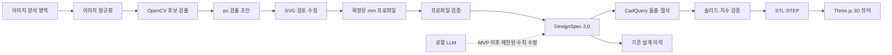

# Track D — 2D 도면 이미지에서 3D CAD 생성 설계

- 상태: 구현 전 설계, D0 위험 검증 통과 후 영구 계약 확정
- 우선순위: 사진 추정보다 먼저 구현
- 목표 입력: 사용자가 형상 영역을 잘라낸 깨끗한 단일 정면 2D 도면 이미지
- 목표 출력: 사용자가 확인한 2D 프로파일, 유효한 3D 솔리드, STL/STEP
- 기존 기반: Phase 1~6의 로컬 LLM, FastAPI, CadQuery, React/Three.js, SQLite 이력

## 1. 문제와 결정

현재 제품은 자연어를 `DesignSpec 1.0`의 box/cylinder 조합으로 바꿔 3D CAD를 만든다. 이미지 업로드, 2D 스케치, 임의 폐곡선 돌출은 지원하지 않는다.

Track D의 첫 릴리스는 **일반 제품 사진 복원**이 아니라 다음 흐름으로 한정한다.

1. 사용자가 깨끗한 정면 도면 PNG/JPEG를 업로드하고 분석할 형상 영역을 지정한다.
2. 시스템이 지정 영역에서 외곽선과 관통 구멍 후보를 추출한다.
3. 사용자가 기준 길이와 돌출 깊이를 입력하고 결과를 확인·수정한다.
4. 확인된 프로파일을 CadQuery로 돌출하고 구멍을 절삭한다.
5. 기존 3D 뷰어와 STL/STEP 다운로드를 재사용한다. 이력 연동은 검출 가능성을 증명한 뒤 추가한다.

일반 사진 한 장은 보이지 않는 뒷면과 절대 치수를 결정할 수 없다. 이를 자동 CAD 변환으로 표시하면 거짓 정밀도가 된다. 사진 입력은 Track D 완료 후 별도 Track V에서 다룬다.

## 2. MVP 범위

### 지원

- PNG, JPEG, WebP 래스터 이미지
- 최대 10 MiB, 디코딩 후 최대 4096×4096 픽셀
- 사용자가 형상만 포함하도록 자르거나 지정한 분석 영역
- 흰 배경/어두운 선 또는 그 반대인 단일 정면도
- 도면 테두리·제목란이 없고 형상선과 치수선이 붙지 않은 입력
- 하나의 닫힌 외곽 프로파일
- 0개 이상의 원형 또는 다각형 관통 구멍
- 사용자가 지정하는 한 개의 기준 선분과 실제 길이(mm)
- 사용자가 지정하는 돌출 깊이(mm)
- 직선 기반 외곽선과 원
- SVG 오버레이에서 프로파일 점과 구멍 수정
- 사용자 확인 후 STL/STEP 출력

### 비범위

- 일반 제품 사진 한 장에서 정확한 치수 추정
- 여러 도면 뷰 또는 전체 도면에서 정면도를 자동 선택
- 정면·측면·평면도의 자동 대응
- 투시 왜곡이 큰 사진, 그림자, 복잡한 배경
- 자유곡선, 스플라인, 필렛, 챔퍼, 나사산
- 여러 깊이를 가진 포켓과 단계 형상
- 숨은선에서 형상 추론
- OCR 결과만 믿고 사용자 확인 없이 CAD 생성
- DXF 편집기나 범용 AutoCAD 대체

## 3. 사용자 완료 시나리오

1. 사용자가 `plate.png`를 드롭하고 분석할 형상 영역을 자른다.
2. UI가 파일 형식과 크기를 검사해 업로드한다.
3. 백엔드가 지정 영역을 정규화하고 외곽선·구멍 후보를 계산한다.
4. UI가 원본 위에 SVG 검출 오버레이를 표시한다.
5. 사용자가 도면의 두 점을 찍고 `100 mm`라고 입력한다.
6. 시스템이 검출 좌표를 mm로 한 번 변환하고 이후 mm 좌표를 정본으로 삼는다.
7. 사용자가 돌출 깊이 `8 mm`를 입력한다.
8. 잘못 잡힌 점이나 구멍이 있으면 SVG 편집기에서 수정한다.
9. UI가 실제 예상 크기와 경고를 보여준다.
10. 사용자가 검출 결과를 명시적으로 확인하고 `3D 생성`을 누른다.
11. 백엔드가 프로파일 검증 → 돌출 → 관통 절삭 → 솔리드 검증 → STL/STEP 내보내기를 수행한다.
12. 기존 Three.js 뷰어가 STL을 보여주고 STEP을 다운로드할 수 있다.

## 4. 아키텍처



핵심 분리:

- 픽셀 검출은 OpenCV가 담당한다. LLM에 픽셀 좌표를 생성시키지 않는다.
- 실제 치수는 사용자 기준 길이로 보정한다. 사진만 보고 mm를 추측하지 않는다.
- 사용자가 확정한 mm 프로파일만 CadQuery와 설계 이력으로 보낸다.
- MVP의 LLM 역할은 기존 텍스트 생성이며, 가져온 프로파일 수정은 명시적으로 허용한 수치 필드만 후속 지원한다.
- 이미지 분석 실패와 LLM 실패, 기하 실패를 각각 다른 오류로 보고한다.

영구 스키마·DB/API 전환 전에 D0 기술 스파이크를 통과해야 한다. D0는 실제 입력 10개를 독립 CLI로 처리해 `normalized.png`, `overlay.svg`, 임시 profile JSON, STEP을 출력한다. 이 결과 없이 `DesignSpec 2.0` 마이그레이션부터 구현하지 않는다.

## 5. 좌표계와 단위

세 좌표계를 섞지 않는다.

| 좌표계 | 원점 | 축 | 단위 |
|---|---|---|---|
| 이미지 | 좌상단 | x 오른쪽, y 아래 | px |
| 스케치 | 기준점 또는 외곽 바운딩 박스 중심 | x 오른쪽, y 위 | mm |
| CAD | 스케치 원점 | x 오른쪽, y 위, z 돌출 방향 | mm |

보정값:

```text
mm_per_px = reference_length_mm / pixel_distance(reference_start, reference_end)
```

변환:

```text
x_mm = (x_px - origin_x_px) * mm_per_px
y_mm = (origin_y_px - y_px) * mm_per_px
```

불변 규칙:

- 내부 단위는 항상 mm다.
- 검출 단계에서는 원본 px 좌표를 보존한다.
- 사용자가 calibration을 확정하면 mm 좌표를 한 번 생성하고 이후 편집·저장·CAD 생성의 정본으로 사용한다.
- 재보정은 기존 mm 좌표를 묵시적으로 덮어쓰지 않고 새 변환 결과를 사용자에게 확인받는다.
- `mm_per_px`는 유한한 양수여야 한다.
- 기준 선분은 최소 20px 이상이어야 한다.
- 실제 길이는 0.1~10,000mm 범위다.
- 돌출 깊이는 0.1~10,000mm 범위다.
- 생성 후 CAD 바운딩 박스 x/y는 스케치 외곽 크기, z는 돌출 깊이와 허용 오차 내에서 일치해야 한다.

## 6. 데이터 계약

### 6.1 D0 PrototypeProfile

D0에서는 영구 API나 DB 스키마를 만들지 않는다. 독립 CLI가 다음 임시 JSON을 출력하고 실제 도면 결과에 부족한 필드가 있는지 검증한다.

```json
{
  "schema_version": "prototype-1",
  "image": {
    "width_px": 1600,
    "height_px": 1200,
    "analysis_region_px": [150, 150, 1450, 1050]
  },
  "calibration": {
    "start_px": [210.0, 1020.0],
    "end_px": [1390.0, 1020.0],
    "length_mm": 100.0,
    "mm_per_px": 0.08474576
  },
  "origin_px": [800.0, 600.0],
  "outer_px": [[210.0, 220.0], [1390.0, 220.0], [1390.0, 980.0], [210.0, 980.0]],
  "holes_px": [
    {"kind": "circle", "center": [500.0, 600.0], "radius": 60.0}
  ],
  "extrusion_depth_mm": 8.0,
  "warnings": []
}
```

이 계약은 폐기 가능한 실험 산출물이다. D0의 10개 실제 입력에서 선 두께, 이중 contour, 끊어진 선, 치수선 결합, 원의 타원 검출 사례를 확인한 뒤 영구 `SketchDraft`를 확정한다.

### 6.2 ConfirmedProfile

사용자가 calibration과 검출 결과를 확인한 시점에 px 좌표를 mm로 한 번 변환한다. 이후 편집, API 전송, 저장, CAD 생성은 다음 mm 프로파일만 사용한다.

```json
{
  "schema_version": "1.0",
  "outer_mm": [[-50.0, -32.2], [50.0, -32.2], [50.0, 32.2], [-50.0, 32.2]],
  "holes_mm": [
    {"kind": "circle", "center": [-25.4, 0.0], "radius": 5.08}
  ],
  "depth_mm": 8.0,
  "confirmed": true
}
```

규칙:

- px 좌표는 검출 근거와 오버레이 재현용이다.
- mm 좌표는 제조 형상과 이력의 정본이다.
- confidence는 UI 표시용이며 유효성 판정의 대체물이 아니다.
- `confirmed=true`가 아니면 CAD 생성을 거부한다.
- D0에서는 revision, job 상태, SQLite 영속성을 넣지 않는다.

### 6.3 DesignSpec 2.0 후보

D0가 실제 도면 10개에서 STEP 생성까지 통과한 뒤 `Part`를 primitive별 판별 공용체로 바꾸고 `sketch_extrusion`을 추가한다.

```json
{
  "schema_version": "2.0",
  "unit": "mm",
  "name": "imported_plate",
  "parts": [
    {
      "id": "body",
      "primitive": "sketch_extrusion",
      "profile": {
        "outer": [[-50.0, -32.2], [50.0, -32.2], [50.0, 32.2], [-50.0, 32.2]],
        "holes": [
          {"kind": "circle", "center": [-25.4, 0.0], "radius": 5.08}
        ]
      },
      "depth": 8.0,
      "position": {"x": 0.0, "y": 0.0, "z": 0.0}
    }
  ],
  "operations": [],
  "source": {"kind": "drawing_import", "analysis_id": "8f7a3c21"}
}
```

전환 원칙:

- `box`, `cylinder`, `sketch_extrusion`을 각각 독립 Pydantic 모델로 정의한다.
- D0 결과로 프로파일 계약을 확정하기 전에는 기존 DB를 변경하지 않는다.
- 계약 확정 후 모든 신규 저장은 `schema_version: "2.0"`을 쓴다.
- 기존 SQLite의 1.0 JSON은 일회성 DB 마이그레이션으로 2.0 형태로 변환한다.
- 백엔드, 프론트엔드 타입, 프롬프트, builder, diff, 테스트를 한 전환에서 함께 갱신한다.
- 1.0/2.0 런타임 이중 경로를 장기간 유지하지 않는다.

## 7. 이미지 처리 파이프라인

### 7.1 업로드 검증

1. 확장자가 아니라 실제 magic bytes와 디코더 결과를 확인한다.
2. EXIF 방향을 적용한 뒤 EXIF 메타데이터를 제거한다.
3. 픽셀 수와 디코딩 후 메모리 상한을 검사한다.
4. 사용자 파일명을 저장 경로에 사용하지 않는다.
5. 무작위 `import_id` 아래에 정규화 PNG로 저장한다.
6. 원본과 정규화 파일은 웹 정적 루트 밖에 둔다.

오류:

- `unsupported_image`
- `image_too_large`
- `image_decode_failed`
- `image_dimensions_invalid`

### 7.2 정규화

1. EXIF 방향 적용
2. 알파 채널을 흰색에 합성
3. grayscale 변환
4. 긴 변이 2048px를 넘으면 분석 사본만 축소
5. 대비 정규화
6. Otsu 또는 adaptive threshold 후보 생성
7. 선이 흰색이 되도록 극성 통일
8. 작은 노이즈만 morphology open으로 제거

원본 좌표와 분석 좌표 사이의 scale을 기록해 결과를 원본 좌표로 되돌린다.

### 7.3 외곽선 검출

1. 사용자가 지정한 analysis region 밖의 픽셀을 제거한다.
2. `findContours(RETR_TREE)`로 contour와 포함 관계를 얻는다.
3. 최소 면적·둘레 미만 후보를 제거한다.
4. 영역 테두리와 일치하는 프레임을 제거한다.
5. 굵은 선에서 생긴 안쪽·바깥쪽 이중 contour를 후보 쌍으로 표시한다.
6. `approxPolyDP`로 직선 기반 프로파일을 단순화한다.
7. 유효 폐곡선들을 outer 후보로 반환한다.
8. 선택된 outer 내부 contour를 hole 후보로 분류한다.
9. 원형도와 `HoughCircles` 결과가 합의하면 circle로 저장한다.
10. 나머지 닫힌 구멍은 polygon으로 저장한다.

전체 도면에서 가장 큰 contour를 무조건 정답으로 확정하지 않는다. 후보가 여러 개면 사용자가 outer를 선택하고, 끊어진 선은 자동 연결하지 않고 `open_contour`로 표시한다.

### 7.4 프로파일 유효성

CAD 생성 전에 다음을 모두 검사한다.

- outer는 점 3개 이상의 단순 폐곡선
- 연속 중복점과 길이 0인 edge 없음
- self-intersection 없음
- 면적이 0보다 큼
- 모든 hole이 outer 내부에 있음
- hole이 outer 경계와 교차하지 않음
- hole끼리 교차하지 않음
- circle radius가 양수
- 최소 edge와 최소 간격이 0.1mm 이상
- 전체 크기가 10,000mm 이하

검사 실패 시 자동으로 점을 이동하거나 구멍을 삭제하지 않는다. 문제 entity와 좌표를 반환한다.

## 8. CAD 변환

`sketch_extrusion` 변환 순서:

1. XY workplane에 outer polygon을 그려 닫는다.
2. outer를 `depth`만큼 +Z로 extrude한다.
3. polygon hole은 별도 wire로 만들고 전체 깊이로 cut한다.
4. circle hole은 중심과 반지름으로 원통 cut을 수행한다.
5. 결과가 단일 solid인지 확인한다.
6. 유효성, 부피, 바운딩 박스를 검사한다.
7. STL과 STEP을 내보낸다.

실패 경계:

- `profile_invalid`: 입력 토폴로지 오류
- `calibration_missing`: 기준 길이 없음
- `depth_missing`: 돌출 깊이 없음
- `sketch_build_failed`: wire 생성 실패
- `geometry_failed`: 돌출/절삭 실패
- `geometry_invalid`: 닫힌 단일 solid가 아님
- `dimension_mismatch`: 결과 치수가 스펙과 허용 오차 밖
- `export_failed`: STL/STEP 저장 실패

## 9. REST API

기존 `/api/v1/design`은 텍스트 생성용으로 유지한다. 첫 MVP는 분석 시간이 짧은 로컬 단일 사용자 흐름이므로 동기 API 두 개로 시작한다.

| 메서드 | 경로 | 입력 | 출력 |
|---|---|---|---|
| `POST` | `/api/v1/drawing/analyze` | multipart image + analysis region | analysis ID, px 검출 후보, 정규화 이미지 경로, 경고 |
| `GET` | `/api/v1/drawing/analyses/{id}/image` | — | 정규화 PNG |
| `POST` | `/api/v1/drawing/generate` | analysis ID + ConfirmedProfile + 이름 | 기존 형식의 DesignResponse |

규칙:

- OpenCV 처리는 `run_in_threadpool`에서 실행하고 event loop를 막지 않는다.
- 분석 결과 수정은 프론트엔드 로컬 상태에서 수행한다.
- generate 요청은 전체 `ConfirmedProfile`을 보내며 서버가 다시 검증한다.
- `confirmed=true`, 유효 calibration 결과, depth, 프로파일 검증이 없으면 생성하지 않는다.
- 한 요청 안에서 실패 원인이 확정되므로 초기 MVP에 job 상태, SSE, PATCH, revision 충돌을 넣지 않는다.
- 실제 측정에서 분석 p95가 3초를 넘거나 작업 복구 요구가 확인될 때만 비동기 job으로 전환한다.

후속 비동기 전환이 필요하면 `POST /imports`, `GET /imports/{id}`, SSE, revision 기반 PATCH를 추가한다. 필요가 확인되기 전에는 이 계약과 SQLite 테이블을 만들지 않는다.

## 10. 임시 파일과 후속 영속성

MVP 파일 규약:

```text
imports/{analysis_id}/normalized.png
imports/{analysis_id}/overlay.svg
artifacts/{design_id}-v{version}.stl
artifacts/{design_id}-v{version}.step
```

- 업로드 원본은 검증·정규화 직후 폐기하고 EXIF가 제거된 PNG만 임시 보관한다.
- `overlay.svg`는 서버가 좌표 데이터로 생성하며 업로드 SVG를 그대로 제공하지 않는다.
- analysis 임시 파일은 프로세스 시작 시와 24시간 주기로 정리한다.
- 생성된 `DesignSpec 2.0`과 CAD 이력은 기존 설계 저장소를 사용한다.
- 작업 중 draft 복원, job 상태, SQLite `drawing_imports` 테이블은 MVP 완료 후 실제 요구가 확인될 때 추가한다.
- 정리 중 현재 요청이 사용하는 analysis 디렉터리는 삭제하지 않는다.

## 11. 프론트엔드

현재 좌측 프롬프트 카드에 `텍스트로 만들기`와 `도면에서 만들기` 탭을 추가한다.

도면 탭 구성:

1. 업로드 영역
2. 형상 분석 영역 자르기
3. 원본 + 검출 SVG 오버레이
4. 도구: outer 후보 선택, 점 이동·추가·삭제, 원형 구멍 추가·삭제
5. 기준 길이 도구: 두 점 선택 + mm 입력
6. 돌출 깊이 입력
7. undo/redo
8. 실제 예상 크기 표시
9. 경고 목록과 문제 entity 강조
10. `검출 결과 확인`과 `3D 생성`을 분리한 버튼
11. 생성 후 기존 Viewer·다운로드 패널 재사용

UX 불변 규칙:

- 수천 개 entity를 다루지 않으므로 Canvas 대신 SVG를 사용한다. polygon, circle, handle을 DOM 요소로 두어 hit testing과 자동화 검증을 단순화한다.
- 자동 검출 confidence가 높아도 사용자 확인 전 생성 버튼을 활성화하지 않는다.
- 검출 결과와 실제 mm 보정값을 동시에 보여준다.
- 자동 수정하지 않고 어떤 선·구멍이 유효하지 않은지 강조한다.
- calibration 확정 후 편집은 mm 좌표에 적용하고 SVG는 이를 화면 좌표로 투영한다.
- 모바일에서는 보기만 허용하고 점 편집은 데스크톱 포인터 환경으로 제한한다.
- 이미지 px, 프로파일 mm, SVG viewport 변환을 하나의 모듈에서 관리한다.

## 12. 로컬 LLM의 역할

Track D MVP에서 로컬 LLM은 이미지 윤곽 검출과 프로파일 편집의 필수 구성요소가 아니다. 서버에는 계속 포함되며 다음에 사용한다.

- 기존 텍스트 → CAD 생성
- 사용자가 명시한 도면 설명에서 설계 이름 추출
- MVP 이후 확인된 프로파일의 제한된 수치 수정: 돌출 깊이, 명시한 원형 구멍의 반지름·x/y 위치
- 후속 단계에서 OCR 토큰과 기하 후보 관계 해석

MVP에서 LLM에 맡기지 않는 수정:

- 임의 edge 이동과 polygon topology 변경
- 점 추가·삭제
- 필렛·챔퍼
- 일부 구간 offset
- 새로운 복합 프로파일 생성

LLM이 해서는 안 되는 일:

- 기준 길이 없이 절대 mm 추정
- 픽셀 좌표를 임의 생성
- 없는 뒷면 형상을 사실처럼 확정
- 검증 실패 프로파일을 조용히 고쳐 성공 처리

OCR은 1차 MVP 이후 CPU 기반 엔진으로 추가한다. OCR이 읽은 치수는 candidate로 표시하고 사용자가 확인하기 전 실제 치수로 확정하지 않는다. GPU OCR/비전 모델을 Qwen과 동시에 올려 6GB VRAM을 경쟁시키지 않는다.

## 13. 의존성 결정

MVP 신규 런타임 의존성:

- `opencv-python-headless`: 디코딩, threshold, contour, 원 검출
- `shapely`: self-intersection과 포함·교차 검증
- `python-multipart`: FastAPI 파일 업로드

후속 OCR 후보는 고정하지 않는다. Windows Python 3.11 설치 크기, 한국어/숫자 치수 인식률, CPU 지연시간을 동일 평가셋에서 측정한 뒤 선택한다. OCR 패키지를 선택하기 전에는 requirements에 넣지 않는다.

## 14. 보안과 오류 경계

- 허용 이미지 포맷만 디코딩하고 업로드한 SVG/PDF를 직접 렌더하지 않는다.
- 압축 해제 후 픽셀 수로 decompression bomb를 차단한다.
- 경로는 서버 생성 ID만 사용하고 사용자 파일명을 로그 표시 외 용도로 쓰지 않는다.
- 이미지와 도면 내용은 외부 API로 전송하지 않는다.
- EXIF 위치·장치 메타데이터를 저장하지 않는다.
- API 오류에는 서버 절대 경로와 스택 트레이스를 포함하지 않는다.
- `import_id`와 `design_id`는 경로 구성요소 검증 후 사용한다.
- 이미지 분석, LLM, CAD, export 오류를 한 종류로 뭉치지 않는다.

## 15. 검증 계획

### 자동 검사

- 업로드 포맷·크기·픽셀 상한
- EXIF 회전과 메타데이터 제거
- 분석 영역 밖 픽셀 제외
- 이미지 px → mm 단일 변환
- mm → SVG viewport 투영과 왕복 오차
- polygon self-intersection 거부
- outer 밖 hole 거부
- 서로 겹치는 hole 거부
- calibration, confirmation, depth 누락 시 generate 거부
- sketch extrusion 바운딩 박스와 깊이
- 원형·다각형 관통 구멍의 부피 감소
- source 경로 조작 차단
- D0 통과 후 DesignSpec 1.0 → 2.0 DB 마이그레이션

### 평가셋 단계

**D0 위험 검증 10개**:

- 실제 사용자가 제공할 형식과 가까운 깨끗한 도면
- 사각형, L/U형, 원형 구멍, 굵은 선, 치수선 인접 사례 포함
- 각 입력에서 normalized PNG, SVG 오버레이, profile JSON, STEP을 사람이 확인

**MVP 회귀셋 30개**:

- 사각형 5
- L/T/U형 직선 프로파일 10
- 원형 구멍 1~4개 5
- 다각형 구멍 5
- 노이즈·저대비·역상 각 1개 이상 5

**릴리스 정확도셋 100개 이상**:

- MVP 30개와 겹치지 않는 입력을 포함한다.
- 이미지 성공률, outer entity, hole entity, 좌표 오차, 최종 CAD 성공률을 별도로 계산한다.
- 30개 결과를 제품 정확도 95%의 근거로 사용하지 않는다.

각 케이스에 원본 이미지, 정답 프로파일 좌표, 기준 길이, 깊이, 정답 바운딩 박스를 둔다.

### MVP 완료 기준

1. D0 실제 도면 10개가 수동 보정 포함 STEP 생성까지 도달한다.
2. 깨끗한 회귀 도면 30개에서 outer 검출 성공 30/30.
3. 30개 회귀셋에서 hole entity 재현율 95% 이상, 오검출률 5% 이하.
4. 자동 결과가 틀린 케이스도 SVG UI에서 수정 후 전부 생성 가능.
5. 확인된 30개 프로파일 모두 유효한 단일 solid 생성.
6. x/y/z 바운딩 박스 오차가 각 축 `max(0.5mm, 0.5%)` 이하.
7. STL/STEP이 생성되고 다시 읽었을 때 유효 solid다.
8. 실제 브라우저에서 업로드 → 영역 지정 → 보정 → 수정 → 3D 생성 → 다운로드를 관찰한다.
9. 외부 네트워크 요청 없이 전체 흐름이 동작한다.

단위 테스트만으로 완료 처리하지 않는다. 실제 스캔 또는 캡처 이미지와 실제 브라우저 스모크가 필수다. 95% 제품 정확도 표기는 독립 100개 이상 평가셋을 통과한 뒤에만 사용한다.

## 16. 구현 순서

### D0 — 위험 우선 기술 스파이크

- 실제 도면 10개를 먼저 확보한다.
- 저장소 영구 스키마와 API를 건드리지 않는 독립 CLI를 만든다.
- 정규화, contour·circle 후보, SVG 오버레이, 임시 profile JSON을 출력한다.
- 사용자가 기준 길이와 깊이를 넣은 profile로 CadQuery STEP을 생성한다.
- 입력별 자동 outer 선택 여부, 검출 hole 수, 수동 수정 횟수, 분석 시간, 실패 유형을 기록한다.
- 선 두께, 이중 contour, 끊어진 선, 치수선 결합 실패를 재현 자료와 함께 남긴다.

완료 조건: 10개 모두 실패 원인이 설명되고, 수동 후보 선택·보정을 포함해 유효 STEP 생성 경로가 확인되며 영구 계약에 필요한 필드가 식별된다. 이 조건 전에는 DesignSpec 2.0과 DB 마이그레이션을 시작하지 않는다.

### D1 — 영구 계약과 기하 기반

- D0 결과로 `SketchDraft`와 `ConfirmedProfile`을 확정한다.
- `DesignSpec 2.0` 판별 공용체와 `sketch_extrusion`을 구현한다.
- 1.0 데이터의 일회성 마이그레이션을 작성한다.
- 토폴로지·치수 검증과 정답 프로파일 테스트를 추가한다.

완료 조건: 이미지 없이 mm JSON fixture만으로 프로파일 → 유효 STEP/STL이 생성되고 기존 설계가 마이그레이션된다.

### D2 — 이미지 분석과 회귀셋

- 업로드 검증, analysis region, 정규화를 구현한다.
- contour·circle 후보와 SVG 오버레이를 생성한다.
- px → mm 확정 변환을 구현한다.
- 30개 회귀셋과 항목별 정확도 보고서를 만든다.

완료 조건: 평가 결과와 실패 유형이 기록되고 자동 확정하지 못한 입력은 명시적 후보/경고로 반환된다.

### D3 — 최소 동기 API

- `/drawing/analyze`, 분석 이미지 조회, `/drawing/generate`를 구현한다.
- OpenCV를 threadpool에서 실행한다.
- 임시 파일 정리와 구조화 오류를 구현한다.

완료 조건: job, SSE, 별도 import DB 없이 한 브라우저 세션에서 분석과 생성이 완결된다.

### D4 — SVG 검토 UI

- 업로드와 analysis region 선택
- SVG overlay와 outer 후보 선택
- 기준 길이·깊이 입력
- 점·구멍 수정과 undo/redo
- 기존 3D Viewer 연결

완료 조건: 사용자가 자동 오검출을 SVG UI에서 고쳐 CAD를 생성한다.

### D5 — 실제 E2E와 MVP 안정화

- 30개 회귀 도면 전체 생성
- 실제 브라우저 스모크
- 반복 실행과 메모리·디스크 측정
- 문서와 실행 명령 갱신

완료 조건: §15의 MVP 완료 기준을 모두 충족한다.

### D6 — 필요가 확인된 운영 기능

- 분석 p95가 3초를 넘으면 비동기 job과 SSE를 추가한다.
- 작업 복구 요구가 확인되면 SQLite draft 영속성과 revision 충돌 제어를 추가한다.
- 실제 보존 요구에 맞춰 원본·임시 파일 정리 정책을 확장한다.

측정이나 사용자 요구 없이 D6를 D0~D5보다 먼저 구현하지 않는다.

### D7 — OCR 치수 후보

- 숫자·단위·치수선 후보 검출
- geometry와 OCR 연결
- 사용자 확인 UI
- 100개 이상 독립 평가셋에서 인식률과 지연시간 측정

D0~D5 완료 전에는 OCR을 선행하지 않는다. OCR 오류와 프로파일 오류를 동시에 디버깅하면 실패 원인이 섞인다.

## 17. 후속 Track V — 일반 사진

Track D와 별도로 다룬다.

- 배경 제거와 물체 분할
- 카메라/투시 보정
- 기준 물체 또는 사용자 기준 치수
- 여러 시점 사진 정합
- 보이지 않는 형상은 가정 목록으로 표시
- 후보 3D를 만든 뒤 사용자 확인

단일 사진에서 얻을 수 없는 정보를 자동 확정하지 않는다. 최소한 기준 길이 하나 또는 알려진 크기의 기준 물체를 요구한다. 제조용 STEP은 사용자가 치수와 형상을 확인한 뒤에만 내보낸다.

## 18. 최종 결정

- 첫 구현 대상은 **사용자가 영역을 지정한 정면 2D 도면 → 단일 깊이 돌출 CAD**다.
- 일반 사진 자동 복원은 별도 Track V다.
- 첫 코드는 영구 기능이 아니라 실제 도면 10개를 처리하는 D0 독립 CLI다.
- OpenCV가 픽셀 후보를 검출하고 사용자가 실제 치수와 outer를 확정한다.
- calibration 확정 후 mm 좌표가 유일한 제조 데이터 정본이다.
- 로컬 LLM은 유지하지만 픽셀 검출, 절대 치수 추정, 임의 topology 수정에는 사용하지 않는다.
- D0 통과 후 `DesignSpec 2.0` 판별 공용체와 일회성 DB 마이그레이션을 수행한다.
- MVP API는 동기로 시작하고 job·SSE·draft DB는 측정된 필요가 있을 때만 추가한다.
- 2D 편집은 Canvas가 아니라 SVG로 구현한다.
- 성공 기준은 데모 화면이 아니라 실제 입력, 고정 평가셋, 치수 오차, 유효 solid, 실제 브라우저 E2E다.
