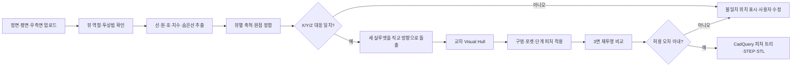

# Track V — 3면도·사진 기반 CAD 리버스 엔지니어링 설계

- 기준일: 2026-10-15
- 목표: 정면·평면·우측면 도면 또는 다중 사진에서 검증 가능한 3D 형상을 만들고, 가능한 범위에서 편집 가능한 STEP/CadQuery 모델로 복원한다.
- 비목표: 사진 세 장만으로 보이지 않는 형상과 실제 치수를 임의 추정해 정확한 CAD라고 표시하는 것.

## 구현 현황

2026-10-15 기준 V1a·V2a가 구현됐다.

- React에 정면·평면·우측면 고정 업로드 슬롯과 제1각/제3각 선택, 공통 X/Y/Z 치수 입력 추가
- `POST /api/v1/multiview/analyze`, `POST /api/v1/multiview/generate`, 분석 이미지 조회 API 추가
- `DesignSpec 2.0`에 `orthographic_intersection` 선언형 part 추가
- CadQuery에서 정면(XZ)·평면(XY)·우측면(YZ) 프로파일을 직교 돌출하고 교집합 계산
- 분석 TTL 저장, 사진성 입력 차단, SQLite 이력, Three.js, STEP/STL 다운로드 연결
- 직육면체·L형 기하 회귀, live API, 실제 Edge 브라우저 upload→analyze→generate 검증

아직 구현되지 않은 범위는 뷰별 회전·crop·기준점 축척, 재투영 IoU, 숨은선 기반 포켓,
실제 3면도+STEP 10세트, Drawing2CAD, COLMAP 사진 스캔이다.

## 1. 결론

현재 Track D는 단일 정면 프로파일을 한 깊이로 돌출하는 기능이다. 3면도 대응이나 일반 제품 CAD 리버스 엔지니어링이 아니다.

Track V는 입력을 두 경로로 분리해야 한다.

1. **3면 정투상 도면 경로**: 정면·평면·우측면의 축척과 기준점을 맞춘 뒤 결정론적 형상 연산으로 CAD를 만든다. 치수 정확도와 편집 가능성이 우선이다.
2. **다중 사진 스캔 경로**: 최소 20~60장 또는 회전 영상을 COLMAP 계열로 점군·메시화한 뒤 평면·원통·구멍을 피팅한다. 사진 세 장은 정확한 치수 CAD를 보장할 정보가 부족하다.

AI는 선 종류·치수·피처 의미 해석과 후보 제안에 사용한다. 최종 형상은 기하 제약, 재투영 오차, 사용자 확인으로 확정한다. 이미지→메시 생성 모델의 결과를 곧바로 제작용 CAD로 취급하지 않는다.

## 2. 현재 구조와 필요한 변경

| 항목 | 현재 Track D | Track V 목표 |
|---|---|---|
| 입력 | 정면 이미지 1장 | 정면·평면·우측면 3장 또는 한 장의 3면도 영역 |
| 축척 | 기준선 1개 | 뷰별 축척 후 공통 X/Y/Z 길이 일치 검증 |
| 정합 | 없음 | 각 뷰 원점, 축 방향, 투상법, 공통 모서리 대응 |
| 형상 | 단일 프로파일 돌출 | 교차 돌출, 포켓, 관통공, 단계 형상, 대칭 피처 |
| 결과 검증 | 외곽 치수 | 각 뷰 재투영 오차와 치수 잔차 |
| 사진 | 차단 | 별도 다중 사진 스캔 작업으로 분리 |
| 수정 | 포인트·자연어 | 피처 트리와 치수 파라미터 수정 |

## 3. 3면도 처리 파이프라인



### 3.1 입력 계약

- 필수 슬롯: `front`, `top`, `right`.
- 각 슬롯: 원본 파일, crop, 회전, 반전, 기준점 두 개, 실제 기준 길이, 선 종류 후보.
- 투상법: 제1각법/제3각법을 사용자가 선택한다. 자동 추정값은 확정값이 아니다.
- 대응 축:
  - 정면: X×Z
  - 평면: X×Y
  - 우측면: Y×Z
- 일관성 조건: 정면 X=평면 X, 평면 Y=우측면 Y, 정면 Z=우측면 Z.
- 한 장에 3면도가 배치된 경우에도 내부적으로 세 crop으로 분리해 같은 계약을 사용한다.

### 3.2 결정론적 1차 복원

단순 부품은 AI 없이 다음 방식으로 복원한다.

- 정면 실루엣을 Y 방향으로 돌출한 솔리드
- 평면 실루엣을 Z 방향으로 돌출한 솔리드
- 우측면 실루엣을 X 방향으로 돌출한 솔리드
- 세 솔리드의 교집합을 초기 `visual_hull`로 사용
- 각 뷰에 공통으로 대응되는 원은 원통형 관통공 후보
- 숨은선과 단면선이 뒷받침될 때만 포켓·내부 홈 후보 생성

실루엣 교집합만으로 구분되지 않는 오목 형상은 자동 확정하지 않는다. 후보 피처와 재투영 차이를 UI에 표시한다.

### 3.3 데이터 계약

```text
MultiViewAnalysis
  analysis_id
  projection: first_angle | third_angle
  views.front/top/right
    image_size
    region
    calibration
    entities[]: line | arc | circle | dimension | centerline | hidden
  correspondence[]
  consistency_errors[]
  warnings[]

ConfirmedMultiViewModel
  analysis_id
  coordinate_system
  dimensions {x, y, z}
  features[]: base_visual_hull | extrusion | cut | hole | pocket
  projection_tolerance_mm
  confirmed: true
```

`DesignSpec`에는 임의 Python 대신 검증 가능한 피처 공용체를 추가한다. CadQuery 코드는 서버의 고정 빌더만 실행한다.

### 3.4 API·UI

- `POST /api/v1/multiview/analyze`: 3개 이미지와 뷰 역할을 받는다.
- `POST /api/v1/multiview/generate`: 사용자 확정 정합·피처만 받는다.
- 업로드 UI는 3개 고정 슬롯, 축 방향 미리보기, 제1각/제3각 선택을 제공한다.
- 검증 표는 뷰별 축척, X/Y/Z 대응 오차, 미해결 선, 재투영 IoU를 표시한다.
- 뷰가 빠졌거나 대응 치수가 허용 오차를 넘으면 생성을 차단한다.
- 3D 선택과 2D 선을 양방향 강조해 어떤 피처가 어떤 선에서 나왔는지 추적 가능하게 한다.

## 4. 일반 제품 사진 경로

정투상 도면과 제품 사진은 같은 분석기로 처리하지 않는다.

1. 촬영 가이드: 고정 초점, 균일 조명, 무광 배경, 대상 주위 360°, 높이 2~3단, 최소 20~60장.
2. 카메라 자세·희소 점군: COLMAP.
3. 밀집 점군·메시: COLMAP MVS 또는 라이선스 검토를 마친 별도 엔진.
4. 실제 축척: 자/마커/알려진 길이로 보정.
5. CAD 피팅: RANSAC 평면·원통·구, 모서리 교차, 대칭축, 반복 구멍 탐지.
6. 피처 트리 후보: extrusion, revolve, hole, fillet 후보를 생성하되 사용자가 확정.
7. 원본 사진에 CAD를 재투영하고 픽셀·치수 잔차를 표시.

사진 경로의 1차 산출물은 **참조 메시/점군**이다. STEP은 피팅과 검증이 끝난 후에만 제공한다.

## 5. 오픈소스·AI 조사

| 프로젝트 | 입력→출력 | 라이선스/제약 | 판정 |
|---|---|---|---|
| [Drawing2CAD](https://github.com/lllssc/Drawing2CAD) | Front/Top/Right SVG 벡터→CAD sequence | MIT. Python 3.9/CUDA 11.8+. 공개 README에 즉시 사용 가능한 pretrained checkpoint 절차가 없음 | **실험 1순위**. 3면 벡터 표현과 학습 코드를 재사용하되 직접 학습·평가 필요 |
| [PlankAssembly](https://github.com/manycore-research/PlankAssembly) | 3면 직교 선 도면→plank shape program | AGPL-3.0, Python 3.8/PyTorch 1.10/CUDA 11.3. 판재 조립 형상에 특화 | 연구 baseline. 폐쇄형/상용 배포에는 라이선스 부담, 일반 기계 부품용 아님 |
| [Ortho2CAD](https://github.com/AdityaJoglekar/Ortho2CAD) | 래스터 정투상 도면→CadQuery 코드 | Qwen3-VL 8B 기반. 저장소에 명시적 LICENSE 파일이 없고 학습 중심 | 논문·평가 구조 참고만. 라이선스 확인 전 코드/모델 채택 금지, RTX 4050 6GB에는 과대 |
| [CAD2Program](https://github.com/manycore-research/CAD2Program) | 2D 도면→파라메트릭 프로그램 연구 | 공개 저장소는 프로젝트 웹사이트 코드뿐 | 제품 의존성으로 사용 불가 |
| [CAD-Recode](https://github.com/filaPro/cad-recode) | 정규화 점군 256점→CadQuery Python | Qwen2 1.5B 계열, CC BY-NC 4.0, 생성 코드가 무효일 수 있어 별도 sandbox 권고 | 비상업 benchmark만. 제품 코드 실행 경로에는 사용 금지 |
| [Point2CAD](https://github.com/prs-eth/point2cad) | surface-id가 붙은 점군→surface/edge/corner | README는 CC BY-NC 4.0으로 설명하며 저장소 라이선스 표기와 불일치. 입력에 surface segmentation 필요 | 연구 baseline만. 법적·입력 계약 문제로 제품 채택 보류 |
| [COLMAP](https://github.com/colmap/colmap) | 다중 사진→카메라·점군·MVS | New BSD, Windows binary와 PyCOLMAP 제공 | **사진 스캔 1순위**. 단, 3장만으로 정확한 CAD를 만드는 도구는 아님 |
| [OpenMVS](https://github.com/cdcseacave/openMVS) | 자세+점군→밀집 점군·메시 | AGPL-3.0 | 기술적으로 유효하나 배포 라이선스 검토 필요 |
| [Meshroom](https://github.com/alicevision/Meshroom) | 다중 사진→메시 | MPL-2.0, CUDA MVS | 데스크톱 실험 후보. 서버 제품 통합보다 외부 파이프라인 검증에 적합 |
| [Hunyuan3D-2mv](https://github.com/Tencent-Hunyuan/Hunyuan3D-2) | 다중 이미지→생성형 메시 | shape 약 6GB VRAM. 라이선스 지역에서 대한민국 제외 | **채택 금지**. 현재 위치·GPU 여유·정확 CAD 목적 모두 부적합 |
| [Stable Fast 3D](https://github.com/Stability-AI/stable-fast-3d) | 단일 사진→텍스처 메시 | Stability AI Community License | 시각화용 메시 모델이며 치수·피처 CAD가 아님 |

### 핵심 판단

- 현재 RTX 4050 6GB에서는 기존 1.5B LLM과 대형 VLM/3D diffusion을 동시에 유지하기 어렵다.
- 가장 먼저 구현할 기능은 AI 모델 추가가 아니라 **3면 입력 계약 + 교차 돌출 + 재투영 검증**이다.
- Drawing2CAD는 라이선스가 가장 명확하고 문제 정의가 가깝지만 벡터 전처리와 모델 학습이 필요하다.
- 생성형 이미지→3D 모델은 보기 좋은 메시를 만들 수 있지만 제조 치수와 편집 가능한 피처 트리를 보장하지 않는다.
- 외부 모델이 만든 Python/CadQuery 코드는 현재 제품의 선언형 `DesignSpec`으로 파싱·검증하며 직접 실행하지 않는다.

## 6. 구현 단계

### V0 — 입력·평가 계약

- 실제 3면도 10세트와 해당 STEP 정답을 확보한다.
- 제1각/제3각, 숨은선, 중심선, 원·호, 치수선이 포함된 합성 30세트를 만든다.
- 지표: 유효 STEP 비율, 외곽 치수 오차, 투영 IoU, 피처 precision/recall, 사용자 수정 횟수.

### V1 — 3면 업로드·정합

- 세 슬롯 UI와 한 장 3면도 crop 모드를 구현한다.
- 뷰별 회전·축척·원점과 X/Y/Z 대응표를 구현한다.
- 불일치 시 생성 차단과 위치별 오류 표시를 구현한다.

### V2 — 결정론적 Visual Hull

- 세 프로파일의 직교 돌출·교집합을 CadQuery로 구현한다.
- 원형 관통공과 단순 직사각 포켓을 명시적 피처로 구현한다.
- 결과를 세 뷰로 재투영해 입력과 비교한다.

### V3 — 도면 의미 해석

- OpenCV 선·원·호 검출, OCR 치수, 선종류 분류를 분리한다.
- 숨은선·중심선 기반 피처 후보를 사용자에게 보여준다.
- 피처별 근거 선과 confidence를 저장한다.

### V4 — AI 어댑터 평가

- Drawing2CAD를 별도 Linux/WSL 실험 환경에서 학습·평가한다.
- Ortho2CAD는 라이선스가 명시되고 6GB 환경용 모델이 확인될 때만 평가한다.
- AI 결과는 결정론적 재투영 검증을 통과해야 채택한다.

### V5 — 다중 사진 스캔

- 20~60장/영상 촬영 wizard와 COLMAP 작업 큐를 구현한다.
- 점군·메시 뷰어와 실제 축척 보정을 구현한다.
- 평면·원통 피팅부터 시작하고 자유곡면 CAD는 별도 범위로 둔다.

## 7. 완료 조건

- 3개 뷰가 없거나 축·축척이 모순이면 STEP을 만들지 않는다.
- 합성 30세트에서 유효 단일 솔리드 생성률 100%, 외곽 치수 오차 축별 `max(0.5mm, 0.5%)` 이하.
- 실제 3면도 10세트에서 성공률과 수동 수정 횟수를 별도로 보고한다.
- 생성된 모든 피처는 입력 선·치수 근거와 재투영 잔차를 가진다.
- 메시와 파라메트릭 CAD를 UI와 파일 형식에서 명확히 구분한다.
- 라이선스가 불명확하거나 비상업 전용인 모델은 제품 런타임 의존성에 넣지 않는다.
